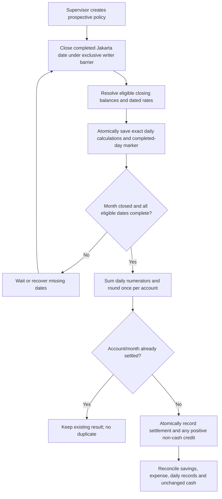

# ADR-0012: Savings interest calculation, daily closing, and monthly posting

Status: Accepted
Accepted by: Project owner, 2026-10-23
Date: 2026-10-23
Scope: Phase 2, one cooperative and the existing single savings account type.
Complements: [ADR-0007](0007-daily-savings-interest-monthly-credit.md).
Implementation: [Backend tech plan](../tech-plan-savings-interest.md).

## Context

The owner approved one annual rate on the whole balance, daily calculation, monthly credit, a global base rate and Supervisor-managed bands. At drafting, daily basis, precision, rate boundaries, effective dates, credit timing and accounting were unresolved (OQ-018 through OQ-022). The owner approved the starting rates on 2026-10-23; real-money readiness is a separate gate.

Phase 1 already has balanced journals and integer-IDR member balances. It supports cash-only transaction kinds and assumes savings equals cash. Interest must be a separate non-cash transaction, without creating a second ledger engine or teller operation.

## Accepted business rules

The project owner explicitly approved these rules and rates on 2026-10-23. This supplements the Accepted business model in ADR-0007.

| Topic | Accepted rule |
| --- | --- |
| Eligible account | The existing single savings account, evaluated per account. Include the IDR 50,000 opening deposit and already credited interest. No product/member aggregation or new minimum earning balance. |
| Daily basis | Closing posted balance for each Asia/Jakarta calendar day, from 00:00 inclusive to next midnight exclusive. Zero balance earns zero. A transaction assigned exactly midnight belongs to the new day. |
| Opening day | Eligible from the opening-deposit posting day, including that day's closing balance. Existing accounts start on feature activation day. |
| Annual convention | Actual/365 Fixed: use actual eligible calendar days and divide by 365, including in leap years. Leap day earns interest with the same denominator. |
| Rate precision | Integer basis points: 100 bps = 1% p.a.; 450 bps = 4.5%. Accept 0 through 10,000 bps as a technical validation range, not an endorsed rate. No binary floating point. |
| Rate selection | One applicable band wins; otherwise use the global base rate. Bands are lower-inclusive, upper-exclusive, nonnegative and nonoverlapping. Explicit gaps use the base rate; nullable upper bound means no limit. Empty bands means base-only. No product override. |
| Rate changes | Supervisor creates an audited complete policy version with a reason, effective tomorrow or later in Jakarta. No historical edits. A new version may supersede a still-pending version for the same date; retain the original for audit. Concurrent writes require the expected latest version. |
| Calculation | Compute each daily numerator B x rate_bps exactly. Sum monthly numerators; divide by 3,650,000 only when calculating the monthly credit. Persist the selected balance, rate and policy for each date. |
| Rounding | Round the monthly total once per account to whole IDR, half up. No daily rounding. Discard fractional residual after monthly rounding; no carry account. |
| Monthly credit | Credit a completed month on the first day of the next month, normally after the previous day closes at 00:05 Jakarta. A partial activation/opening month includes only eligible dates. |
| Compounding | Uncredited daily amounts are not spendable and earn no interest. Monthly credit joins the eligible closing balance on its actual posting day. |
| Late runs | Recover missed dates and complete older months first. Never backdate a credit or revise completed days. A late credit delays compounding; there is no automatic compensation for that delay. This consequence was explicitly accepted. |
| Zero credit | Persist a completed zero settlement; do not create a zero-value financial transaction. |
| Accounting | Retain daily calculation records without daily GL journals. At monthly credit: debit savings_interest_expense, credit member_savings. Monthly recognition is accepted for local implementation; real-money accounting readiness remains separate. |
| KCP and actor | Attribute interest to the member home KCP for reporting. Automatic posting actor is System, not a teller or the Supervisor who configured rates. No teller-cash movement. |
| Deductions | Local validation uses gross interest with no deductions. This is not a tax conclusion. Approve applicable deduction treatment and account mappings before any real-money enablement; add the necessary posting rules first if deductions apply. |
| Activation | Explicit future full business date, earliest tomorrow after compatible deployment. No automatic interest for pre-activation seed/history. First policy establishes the start date. |
| Unavailable workflows | Account closure/freeze, backdating, historical corrections and reversal workflows are outside this increment. Do not invent behavior for them; resolve interest treatment before introducing those features. |

### Approved starting rates

Global base: 300 bps (3% p.a.). Approved starting bands:

| Closing balance B in IDR | Whole-balance annual rate |
| --- | --- |
| 0 <= B < 1,000,000 | 300 bps / 3% |
| 1,000,000 <= B < 10,000,000 | 400 bps / 4% |
| 10,000,000 <= B < 100,000,000 | 450 bps / 4.5% |
| B >= 100,000,000 | 500 bps / 5% |

Exactly IDR 1,000,000 receives 4%; exactly IDR 10,000,000 receives 4.5%; exactly IDR 100,000,000 receives 5%. Re-evaluate the band every day. Do not distribute one balance among several bands. Deployment does not silently activate rates; a Supervisor saves the first prospective policy.

### Worked examples

- IDR 15,000,000 at 450 bps for 30 eligible days: 15,000,000 x 450 x 30 / 3,650,000 = IDR 55,479.452054...; monthly credit IDR 55,479.
- A month-end balance of IDR 15,000,000 becomes IDR 15,055,479 after that credit, assuming no intervening movements. Cash remains unchanged. The journal debits expense and credits savings liability by IDR 55,479.
- A member opens on January 20: January 20-31 contribute 12 daily calculations, if activation was no later than January 20. No January 1-19 rows are required for that member.
- January interest posted late on February 3 contributes to February 3's closing balance, not February 1 or 2. The January interest period and February posting timestamp remain separately visible.
- A calculated monthly amount of IDR 0.49 settles at zero; IDR 0.50 settles at IDR 1. No residual is carried into another month.

## Technical decision

Keep a single interest module within the Go/Gin application and PostgreSQL. Use exact integer numerators, immutable dated policies, unique account/day calculations, a durable day-completion marker, and unique account/month settlements. A small API-owned background loop catches up on startup and periodically; PostgreSQL locks and uniqueness make retries safe across restarts or multiple API instances. No Redis, queue or separate scheduler deployment.

Daily close requires a shared/exclusive PostgreSQL advisory transaction barrier. All money writers, including registration, acquire the shared gate before member/branch locks, then assign the posting timestamp from the DB clock after their relevant locks. The closer obtains the exclusive gate, waits for in-flight writers, and reads a fresh committed snapshot. Reconstruct the chosen closing balance from current balance minus movements at or after that date's next midnight. Persist all eligible account rows and the day-completion marker atomically. Client backdating and backdated demo insertion are unavailable after activation.

This avoids counting a transaction inconsistently when it starts before midnight and commits afterward. Legacy timestamps/snapshots are preserved; their balances establish the activation opening position, without asserting reconstructible pre-activation daily interest.

Monthly posting locks the member and atomically commits the balance delta, interest_credit transaction with before/after snapshots, balanced non-cash journal, completed settlement and system audit. Missing daily coverage blocks that account's credit. Database uniqueness on account/period prevents duplicate payment. Zero amounts still record completed settlement. Failure rolls back the whole posting, and retry returns the existing outcome when already committed.

## Alternatives considered

- Month-end balance / 12: does not meet the confirmed daily model.
- Progressive bands: inconsistent with the owner's whole-balance decision.
- Actual/Actual denominator, daily rounding, or fractional carry: viable business alternatives; fixed 365 and monthly-only rounding are the simpler initial proposal. Owner may select another convention before implementation.
- Recalculate every month without daily records: fewer stored rows but harder to reproduce historical balances/rates and prove complete recovery.
- Read current balances after midnight without coordinating writers: cannot resolve in-flight posting/cutoff consistency.
- Lazy closing inside the first cash operation of each day: couples interest processing to interactive teller latency. Prefer an independent loop and shared writer gate.
- Daily expense/payable journals: defer unless accounting requires them; monthly recognition avoids a second daily financial posting path.
- Reuse deposit for interest: incorrectly suggests teller cash movement. Add an explicit non-cash kind and expense account.
- Scheduler service/Redis/queue or a configurable approval engine: unnecessary for the current one-cooperative MVP.

## Consequences

- Interest increases savings liabilities and expense without increasing physical cash. Phase 1's global cash=savings check must become cash + posted interest expense = savings for this restricted model, alongside per-member liability and per-kind journal checks.
- Transaction enum/read changes require coordinated frontend support. Current clients treat non-deposit rows as withdrawals; they must explicitly support interest_credit, positive signs and System attribution in EN/ID and both themes before activation.
- A brief global daily-close barrier is accepted for this small deployment; measure and bound its lock duration. Jobs must stop cleanly, expose progress/failures and recover without duplicate payments.
- Ordinary cash remains available if the interest loop is disabled. Prospective policy versioning, complete daily records and settlements must survive backups/restores together with money and audit data.
- No source or schema implementation is part of this ADR. No posted financial record may be deleted to roll back the feature; use disabled scheduling and compatible forward fixes.

## Approval and open details

OQ-018 through OQ-020 are resolved by owner acceptance. OQ-021 and OQ-022 are resolved for this local implementation, with real-money deductions and operating/accounting readiness retained as separate gates. Activation is chosen prospectively in the first saved policy.

Acceptance is recorded above and the related documents are aligned. Preserve ADR-0007's original accepted history. Implementation follows the linked tech plan and starts with tests.
