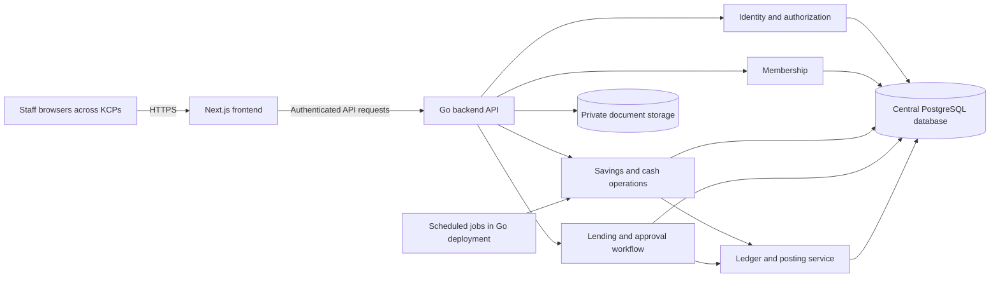
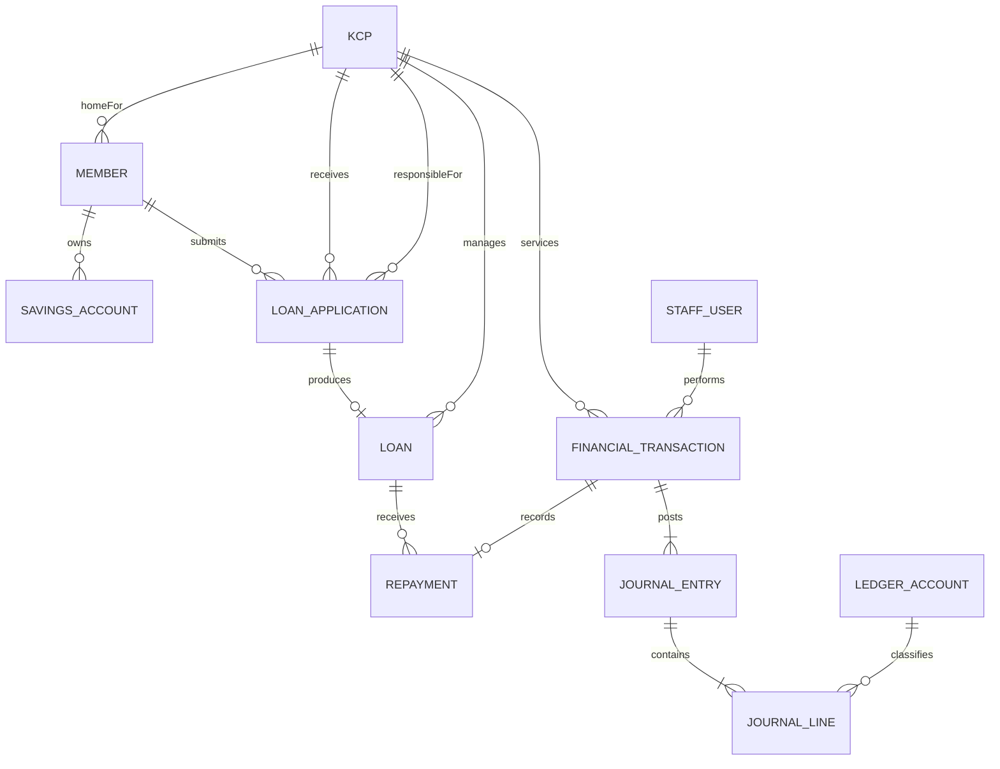

# System Architecture

> Initial MVP: one Go application and Next.js frontend supporting registration, cash deposits, cash withdrawals, and basic lending. Scheduler jobs, comprehensive administration, and advanced workflow configuration below are target-state proposals, not Phase 1 requirements. See [roadmap](roadmap.md).

## Decision status

- **Confirmed:** Go backend and Next.js frontend; one cooperative with multiple KCPs; role-based workflow and matrix-based lending approval.
- **Proposed:** PostgreSQL, one centrally hosted deployment, an online-only financial posting model, REST APIs, and a modular monolith backend.
- **Confirmed frontend direction:** shadcn/ui with the selected tweakcn Zen Inspired Theme; see [frontend design reference](frontend-design.md). Other libraries, hosting, versions, authentication mechanism, and operational sizing remain unselected.

## Proposed topology

The internal boxes represent modules in one Go application, not independently deployed services. API routing through Next.js versus direct browser access to Go remains an implementation decision. All business authorization is enforced by Go regardless of frontend routing.

## Module boundaries

| Module | Responsibility |
| --- | --- |
| Organization and access | KCPs, users, roles, permissions, access scopes |
| Membership | Person identity, unique membership, home KCP |
| Savings | Product rules, accounts, deposits, withdrawals, dated interest policies, daily calculations, monthly interest credits |
| Cash operations | Teller sessions, cash movements, reconciliation |
| Lending | Applications, analysis, authority rules, decisions, loans, schedules, repayments |
| Accounting | Chart of accounts, posting rules, journals, reversal, period controls |
| Audit and reporting | Business audit events, transaction tracing, operational and financial reports |

Modules own their write paths. Financial operations use a shared application-level transaction boundary so domain changes and journal entries cannot commit separately. A separate microservice architecture is not required for the initial scope.

## Conceptual data model

This diagram is not a database migration. Product tables, identity evidence, ledger dimensions, permissions, schedules, and audit details require further design.

The financial transaction relationship describes successfully posted transactions. Journal line balancing, identity uniqueness, and approval limits require additional constraints beyond diagram cardinalities. Loan responsible KCP should initially inherit application responsibility; reassignment policy is open.

## Financial consistency

- Enforce person uniqueness with a database-backed identity rule after the identity policy is agreed.
- Protect withdrawals and repayments against concurrent updates through locking or an equivalent verified strategy.
- Persist idempotency keys, request fingerprints, and outcomes with uniqueness constraints scoped to the operation and caller context.
- Commit balances, loan allocations, journal entries, and a durable business audit event atomically.
- Deliver noncritical side effects such as notifications after commit; introduce an outbox if reliable delivery becomes necessary.
- Do not allow cached balances to authorize spending independently of the transaction database.

## Security and operations

Proposed baseline: server-side authorization, secure sessions, appropriate CSRF protection, rate limits, encrypted transport, restricted document access, secret management, and stronger authentication for privileged operations. Select exact mechanisms during Phase 1.

Use structured logs and correlation IDs without exposing sensitive identity data or secrets. Keep business audit events distinct from diagnostic logs. Define retention and privileged database access controls; application-level append-only journals alone do not guarantee tamper resistance.

Backups require restore drills. Recovery objectives, hosting region, outage procedures, monitoring, and capacity targets must be agreed before a production pilot. The initial centralized proposal blocks posting when connectivity is unavailable; offline processing is a separate design decision.

## References within this project

- [ADR index](adr/README.md)
- [Accounting foundations](accounting.md)
- [Access control](access-control.md)
- [Open questions](open-questions.md)

## Savings interest processing proposal

Daily and monthly jobs reuse Savings and Accounting modules in the Go deployment, not a separate interest microservice. Protect job execution across application instances through database uniqueness and suitable coordination.

Store dated interest-policy versions and bands, reproducible daily balance references, daily calculation records, and monthly credit records linked to financial transactions. Preserve the applicable policy reference and calculation inputs for each business date. Use a system actor for scheduled postings and an approved accounting KCP dimension rather than an invented teller location.

Daily calculation records do not directly increase spendable account balances. Monthly credit records, journal entries, and balance effects commit together. Enforce account/date uniqueness for normal daily accrual and account/period uniqueness for monthly credit, with separately audited corrections. Recovery must fill missing days before the affected account is credited. Define cutoff and ordering between month-end credit and daily balance snapshots before coding.

The business choice is recorded in [ADR-0007](adr/0007-daily-savings-interest-monthly-credit.md); implementation mechanics and day-count conventions remain proposals or open questions.
