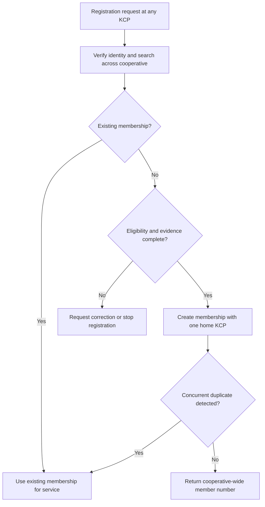
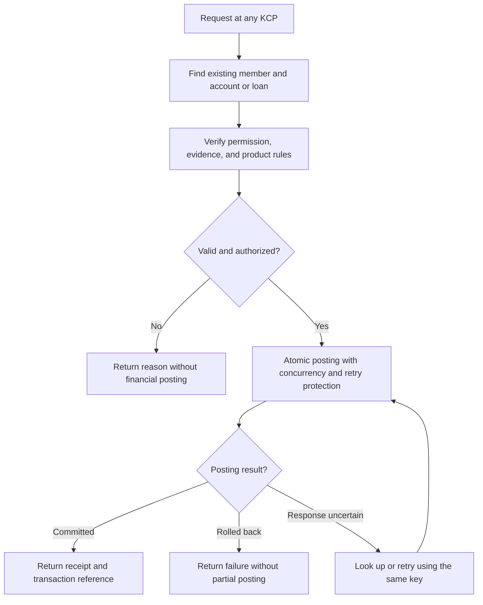
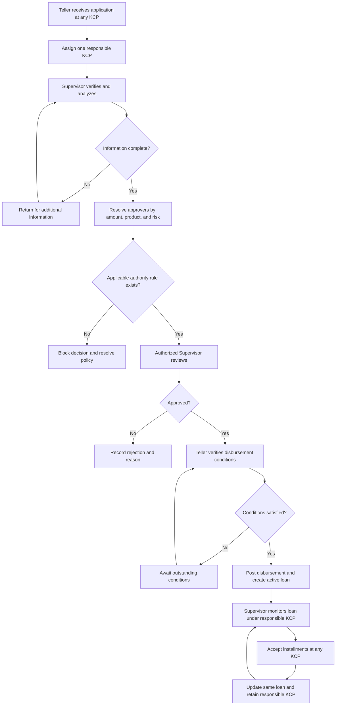

# Business Processes

> Initial MVP uses the registration, cash-service, and simplified lending flows. Savings-interest automation is deferred. Workflow stages may use simple forms and status checks; do not build a general-purpose workflow engine. Basic repayment scope must be settled before live lending. See [roadmap](roadmap.md).

The service locations and lending responsibility model are confirmed. Initial role names are confirmed. Detailed states, validations, task permissions, and exception handling below are proposed for review.

## 1. Member registration

1. An authorized staff member collects identity information at a KCP.
2. Search for an existing person across the cooperative using the agreed identity policy.
3. If an existing membership is found, use that membership for service; do not create another.
4. Otherwise, validate eligibility and atomically create the membership, member number, home KCP, and audit event.
5. A database uniqueness constraint must also handle simultaneous registration attempts.

Identity documents, member eligibility, minors, former members, and home KCP transfer rules remain open.

## 2. Cross-KCP deposits, withdrawals, and installments

1. Staff find the existing member and select the account or loan.
2. Verify staff permission and the required member or payer evidence.
3. Validate product rules, amount, account status, and any required authorization.
4. For cash service, validate the servicing cash session and cash availability as applicable.
5. Post the financial transaction, journal, and account effects in one database transaction.
6. Return a receipt with the transaction reference and servicing KCP.
7. For an uncertain response, look up the original transaction or retry with the same idempotency key.

An idempotent retry returns the original committed outcome. Reusing the same key with different transaction details must fail. Cash handover, receipt reprinting, and uncertain-payment procedures require an operational SOP.

## 3. Loan origination and monitoring

Initial roles are Member, Teller, and Supervisor. The detailed task allocation below is proposed, while Supervisor approval remains subject to the confirmed authority matrix. Staff location alone does not determine permissions.

Proposed application states: Draft, Submitted, Under Review, Awaiting Information, Pending Decision, Approved, Rejected, Cancelled, Disbursed. Loan lifecycle states are separate and will be specified with repayment and closure rules.

Before implementation, define allowed state transitions, who may cancel or amend an application, approval expiry, and whether changes after approval trigger reapproval. This flow does not imply that every loan uses only one individual approver; the authority matrix may require multiple approvals or a committee.

## 4. Correction and branch closing

Proposed correction flow: locate original posting, check reversal authority and period rules, provide a reason, post linked reversing entries, and create a replacement transaction if needed. Posted history remains available.

Proposed daily closing flow: reconcile teller cash, resolve differences under an approved procedure, close cash sessions, and produce KCP reports reconciled to the cooperative ledger. Cash custody, inter-KCP balancing, backdating, and period-lock rules remain open.

## 5. Daily savings interest and monthly credit

The annual rate applies to the entire eligible daily balance according to one band. Calculate daily and credit monthly; see the [process diagram and calculation policy](savings-interest.md#daily-calculation-and-monthly-credit-flow).

Proposed operations: resolve the daily balance and dated policy, persist one daily accrual per account/date, recover missing dates, and credit each account/month once with an atomic journal and balance update. Record the system job as the actor; this is not a teller cash deposit and must not fabricate a servicing KCP. Accounting attribution, monthly credit date, and cutoff remain open.

## Phase 1 lending clarification (2026-10-21)

The project owner explicitly selected loan application and approval only. Disbursement, repayment scheduling, and repayments are deferred until lending rules are agreed. Approval is a workflow decision and does not create loan principal, move cash, or imply disbursement eligibility. Earlier references to a live lending pilot apply only when disbursement is later introduced.