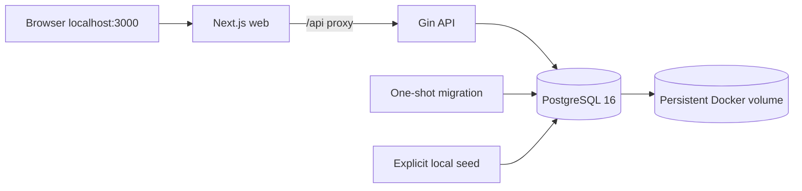

# Local Docker deployment

This Compose stack runs the Phase 1 application on Docker Desktop's Linux engine. It uses a separate PostgreSQL database from the existing WSL setup. It is intended for local review, with HTTP and development staff accounts.

## Prerequisites

- Docker Desktop running with Linux containers and Docker Compose v2 or newer.
- For commands from Ubuntu, enable Docker Desktop **Settings > Resources > WSL Integration > Ubuntu-24.04**. Alternatively, use PowerShell from the project's UNC directory.
- Port 3000 available, or choose another `WEB_PORT`.
- Run all commands from the project root. Host Go, Node.js, npm, and PostgreSQL are not required.

PowerShell project location:

```powershell
Set-Location '\\wsl.localhost\Ubuntu-24.04\home\dhany\workspace\projects\credit-union'
docker compose version
```

## Configuration

On a fresh checkout, copy `.env.docker.example` to `.env.docker` and replace both password placeholders. If `.env.docker` already exists, keep it. A local ignored file with random passwords was created during initial Docker setup; it is not stored in Git.

```bash
cp .env.docker.example .env.docker
```

In PowerShell, the equivalent is `Copy-Item .env.docker.example .env.docker` (first-time setup only).

| Variable | Purpose |
| --- | --- |
| `POSTGRES_PASSWORD` | Required, unique long random database password. Use hexadecimal or alphanumeric characters because this value is interpolated into a connection URL. |
| `DEV_SEED_PASSWORD` | Password of at least 12 characters for the explicitly invoked local seed command. |
| `WEB_PORT` | Host frontend port, default `3000`. The allowed browser origin follows this port. |
| `APPROVAL_LIMIT_IDR` | Default `0`; loan approval stays disabled until authority is agreed. |

Always pass `--env-file .env.docker`. Compose does not consume the existing WSL `.env` or its socket-based database connection. Do not put credentials into Dockerfiles, build arguments, Git, or shell history. Changing `POSTGRES_PASSWORD` after database initialization does not rotate the stored database password.

## Build and start

```bash
docker compose --env-file .env.docker config --quiet
docker compose --env-file .env.docker up --build -d --wait
docker compose --env-file .env.docker run --rm seed
```

The last command creates `teller.a`, `teller.b`, and `supervisor`, using `DEV_SEED_PASSWORD` from `.env.docker`. It also creates the two development KCPs. It does not replace existing passwords and does not create member or financial sample data. Seed is an explicit tool service and does not run on normal startup.

Open **http://localhost:3000** (or the selected `WEB_PORT`) and use `localhost` consistently. Use the generated local password from `.env.docker` to sign in. The API is available through `/api`; API and database ports are not published to the host.

Startup order is database health -> successful initial migration -> API health -> frontend. `migrate` exits with code 0 on success; it is not a long-running service. Schema setup uses ordered, tracked embedded migrations. Version 1 preserves the existing initial schema; version 2 allocates savings account numbers. The one-shot migration service applies pending versions before the API starts.



The frontend uses Next.js standalone output and runs as the Node user. Its internal API rewrite destination is set during image build to `http://api:8080`. The Go runtime runs as a non-root user. Frontend and API images use separate build stages so development toolchains are not included in the runtime images. If a `frontend/public` asset directory is added later, copy it to the frontend runtime stage as well.

## Verify and inspect

```bash
docker compose --env-file .env.docker ps -a
curl --fail http://localhost:3000/api/health
docker compose --env-file .env.docker logs --tail=100 api web migrate
```

Expect `db`, `api`, and `web` to be healthy, and `migrate` to have exited successfully. `/api/health` also checks the database connection. In PowerShell use `Invoke-RestMethod http://localhost:3000/api/health` if `curl` resolves to a PowerShell alias. Check sign-in, member search, and sign-out in the UI. Use deliberate test data when exercising deposits and withdrawals.

## Restart and update

```bash
docker compose --env-file .env.docker stop
docker compose --env-file .env.docker up -d --wait
# After updating source:
docker compose --env-file .env.docker up --build -d --wait
```

`stop` and ordinary `down` preserve the named volume `credit-union_postgres_data`. Do not use `down -v` or remove that volume unless deliberately deleting all Docker database data. The default restart policy restarts application services after Docker restarts; healthchecks report failures but do not themselves restart a running container.

## Backup and rollback

Before updating a stack that contains data, take a database backup. These commands use a Bash terminal with Docker access; keep backups in a private location.

```bash
mkdir -p .local/backups
docker compose --env-file .env.docker exec -T db pg_dump -U credit_union -d credit_union > .local/backups/credit-union.sql
```

Check that the command succeeds and the file is non-empty. Backups contain identity and financial data. Keep `.env.docker` separately so the database remains accessible. Test recovery in a separate database before relying on a backup; do not overwrite the active database as a smoke check.

For an application rollback, return the source to a known previous Docker-compatible commit, then rebuild with `up --build -d --wait`. Retain the database volume. There is no automatic schema downgrade: if a later release changes the schema, review compatibility before rolling back and prefer a forward fix. For the account-number release, retain the additive account column, sequence, and migration ledger during application rollback. Never delete or reset issued account numbers. This local maintenance procedure is not a production zero-downtime migration strategy.

## Troubleshooting

- **Docker unavailable in Ubuntu:** enable Docker Desktop's WSL integration, reopen the Ubuntu terminal, or use the Windows Docker CLI from PowerShell.
- **Cannot connect to Docker engine:** start Docker Desktop and wait for the Linux engine to become ready; check `docker info`.
- **Port in use:** set a free `WEB_PORT` in `.env.docker` and rerun `up -d --wait`. Use the matching localhost URL.
- **Login fails on a fresh database:** run the explicit seed command. On an existing database, changing the seed password variable does not change existing credentials.
- **Database authentication failure after changing the environment:** restore the original password setting or perform a deliberate PostgreSQL password rotation. Do not delete the volume to fix a password mismatch.
- **Migration exits non-zero:** inspect `logs migrate`; keep API stopped until migration succeeds. Do not bypass the dependency.
- **API proxy/health fails:** inspect `ps -a` and `logs api web db`. If building the frontend outside Compose, supply `API_URL` as a build argument for the appropriate reachable API address.

Compose startup dependencies follow the [Docker Compose startup-order documentation](https://docs.docker.com/compose/how-tos/startup-order/). Frontend packaging follows [Next.js standalone deployment](https://nextjs.org/docs/app/getting-started/deploying).

## Initial local validation (2026-10-21)

Validated through the Windows Docker CLI against Docker Desktop's Linux engine (Docker Engine 29.8.2, Compose 5.6.0). Ubuntu WSL integration was not enabled during validation; PowerShell commands from the UNC project directory worked.

- `config --quiet`: passed without printing resolved secrets.
- `up --build -d --wait`: passed; Go binaries and Next.js production/TypeScript build succeeded.
- Database, API, and frontend: healthy; initial migration: exit 0.
- Explicit seed: succeeded with two KCPs and three local staff accounts.
- Frontend `/` and proxied `/api/health`: HTTP 200; database health returned `ok`.
- All three staff accounts: login, `/me`, `/meta`, member/loan reads, and logout passed through the frontend proxy; logged-out sessions returned 401.
- Repeated `up -d --wait`: passed using the same database volume and idempotent schema command.

No member or financial transaction fixtures were inserted during this Docker smoke test. This validation covers local packaging and connectivity, not backup recovery or production readiness.

## Account-number upgrade maintenance

Build images before stopping services. Back up the database first using the backup section above. For a local upgrade that already has data, stop writers while the small transactional backfill runs:

```bash
docker compose --env-file .env.docker build api web
docker compose --env-file .env.docker stop web api
docker compose --env-file .env.docker run --rm --no-deps migrate
docker compose --env-file .env.docker up -d --no-build --wait
```

The migration acquires a transaction-scoped schema-specific advisory lock with a five-second lock timeout, adds the account column/sequence, assigns numbers to existing members, and records version 2 in the same transaction. A lock or migration failure leaves the ledger/schema changes uncommitted; inspect migration logs and resolve the cause before retrying. Keep the database volume. Repeated migration runs retain issued numbers.

Validate member counts, total savings, transaction counts, and journal counts against the pre-upgrade values. Each member must have one distinct non-null 10-digit account number. Existing stored registration replay JSON is intentionally not rewritten; current member lookup supplies its account number. For a large or live production database, plan a phased backfill separately.

### Member balance snapshot migration

Migration 3 adds nullable before/after balance snapshots and consistency constraints. Pause all writers, take a database backup, run the existing migration service, and deploy the updated API/web. Existing transactions keep unknown snapshots; balances and journals are not rewritten. Old API binaries can still insert unknown snapshots, so finish the writer rollout before resuming. Retain the added schema and captured values if rolling back the application; use forward fixes.

## Make shortcuts

From a Bash environment with GNU Make and Docker Compose, use `make up` for build/start/migrations and `make seed` for optional staff plus 15-member demo data. Configure `.env.docker` first. Seed creates a private backup and restores service availability after success or failure; it refuses unrelated existing financial data. See [demo data](../development/demo-data.md).

Use `make release VERSION=v0.1.0` only after intended changes are merged into remote `main`. GitHub CLI authentication and repository write access are required. This publishes a new tag and GitHub Release with generated notes at the resolved remote main SHA; it does not deploy Docker services. Existing tags are refused.
