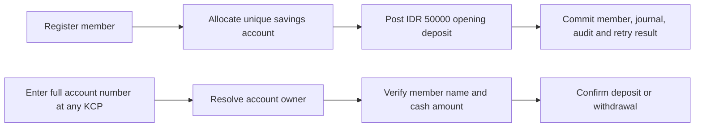
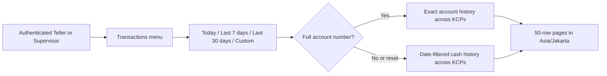

# Phase 1 Implementation Notes

Date: 2026-10-21

## Available for local review

- Gin HTTP API with domain-local handlers/services/PostgreSQL stores, plus small shared platform packages.
- Next.js frontend, official shadcn/ui primitives, and the exact shared tweakcn theme tokens. Fonts are bundled through Fontsource; theme snapshot is tracked at `frontend/theme/zen-inspired.json`.
- Staff login, unique-NIK member registration, opening deposit, cross-KCP cash service, and transaction history.
- Loan intake and Supervisor decisions only; no cash disbursement or loan servicing.

See the [root README](../README.md) for setup, accounts, policy settings, assumptions, and limits.

## Implementation choices for review

| Item | Implemented choice |
| --- | --- |
| Identity | Unique NIK, separate internal/member identifiers and a globally unique 10-digit savings account number; masked NIK in staff projections |
| Opening deposit | IDR 50,000 ordinary savings, atomic with registration |
| Money | Whole-rupiah integers; no binary floating point calculations |
| Transaction boundary | Balance, cash transaction, two journal lines, audit, and idempotency outcome commit together |
| Cross-KCP cash | Servicing KCP follows signed-in staff; home KCP does not change |
| Cash availability | Derived from cash journal lines; zero opening branch cash |
| Approval | Explicit environment limit; regular product and low risk only; no authority by default |
| KCP permissions | Shared member/case lookup; transactions use own KCP; Supervisor can decide across KCPs |
| Loan outcome | Approval/rejection records workflow status and reason only; does not establish final pricing or authorize payout |
| Authentication | Bcrypt passwords; random sessions stored as SHA-256 hashes; strict same-site, HTTP-only cookies; write origin checks |
| Database lifecycle | Separate API/migration/development-seed commands; existing wrapper interface retained |

These implementation choices do not mark all proposed business policies as approved. No zero-interest loan or arbitrary live approval ceiling is assumed. No new infrastructure, microservices, or workflow engine is introduced.

## Verification and remaining work

PostgreSQL integration tests with Go race detector cover the critical financial and access cases; frontend production build includes TypeScript checking. The local login page has been visually checked in the in-app browser. No production load, security audit, or restore drill has been completed.

Still pending before operational rollout: agreed approval limits, member identity correction, product/accounting sign-off, cash transfer/opening procedures, reversal support, backup restore verification, production access setup, and operational acceptance. Phase 2 savings interest remains deferred.

## Gin refactor

`backend/cmd/api/main.go` owns process lifecycle; `internal/platform/app` wires four domains: `auth`, `member`, `cash`, and `loan`. Registration consumes cash posting through a narrow capability and the same caller-owned transaction. Persistent legacy fingerprints are projected explicitly. The Gin refactor itself left the initial schema unchanged; subsequent account-number migration is documented below.

Authentication dependency failures deliberately return 503 instead of 401; missing/wrong credentials and expired sessions still return 401. Log fields exclude identity searches, request bodies, and session material. See [TDD evidence](testing/gin-refactor.tdd.md) for validation and remaining scope.

## Savings account service

Registration now allocates an account such as `1000000001` within the same opening-deposit transaction. Existing members are backfilled once by migration 2. Membership number and home KCP remain unchanged.

`GET /api/members/by-account/:account_number` returns the current masked staff projection after authentication. It uses exact matching, returns 400 for invalid format and 404 for unknown accounts, and does not change `/api/cash` input or retry fingerprints. Account numbers appear in member lists/details, registration feedback, and cash confirmation. The cash form clears the previous member immediately when account input changes.

See [account-number tech plan](tech-plan-savings-account-numbers.md), [ADR-0009](adr/0009-savings-account-numbers.md), and [TDD evidence](testing/savings-account-numbers.tdd.md).

## Account-filtered transaction menu

The dedicated Transactions menu lists cash postings across KCPs, including the registration deposit. Staff can combine an exact account number with Today (default), Last 7 days, Last 30 days, or inclusive Custom dates. Reset restores Today/all accounts. Dates and displayed timestamps follow Asia/Jakarta. Results use 50-row pages with Previous/Next navigation. Rows show the member name, membership/account numbers, date, cash direction and amount, servicing KCP/staff, reference, and note. EN/ID and light/dark preferences remain available.

`GET /api/transactions?account_number=1000000001` is a new read-only cash-domain endpoint for authenticated Teller/Supervisor roles. The filter is optional and exact; malformed values return 400, valid accounts with no matching rows return `200 []`, and anonymous access returns 401. Results use `created_at DESC, id DESC` for deterministic ordering. Existing member history, cash commands, journals, and retry contracts are unchanged.

The frontend aborts obsolete requests and associates each result with its applied filter; it hides stale rows while loading a new result or after an error. A separate component contains the filter and table, sharing the existing API helper. No database migration or new runtime dependency is required for this menu. Existing account-number schema migration remains required.

The account filter uses existing unique account/member-history indexes. A local `EXPLAIN` confirmed those indexes are available; this is not a large-data performance test. The unfiltered small-MVP list can scan/sort the table. Export, additional filters, and a global timestamp index remain deferred. Date filtering and pagination are now available via the separate search endpoint below.

See [transaction-history tech plan](tech-plan-transaction-history.md) and [TDD evidence](testing/transaction-history.tdd.md).

### Date-filtered pagination contract

`GET /api/transactions/search` returns `{items,next_cursor,start_date,end_date,time_zone}`. Optional `period` defaults to `today`; accepted values are `today`, `last_7_days`, `last_30_days`, and `custom`. Custom requires both `start_date`/`end_date` in `YYYY-MM-DD` order; preset requests must omit those fields. Last 7/30 days include today plus 6/29 previous dates. The end date is inclusive using an exclusive following-midnight SQL boundary. Optional `account_number` uses the existing exact validation.

Send `cursor` for the next page together with `period=custom` and the response dates, freezing the range across midnight. `next_cursor` is an empty string on the last page. Cursors are bounded/versioned URL-safe base64 positions bound to account/date scope; malformed or mismatched values return 400. They do not grant access. Every page enforces staff authorization. This is a live listing, not a snapshot/export; refresh to see newer postings. Existing `/api/transactions` retains its original latest-100 array contract; member-specific history is unchanged. No schema changes or new dependencies.

See [date-filter plan](tech-plan-transaction-date-filters.md) and [TDD evidence](testing/transaction-date-filters.tdd.md).

## Member balance ledger snapshots

Cash transactions now include balance_before and balance_after, captured from the actual member UPDATE under the row lock and committed atomically with journal lines/audit/replay data. This includes the registration opening deposit. All three cash-history endpoints return these additive integer IDR fields; historic unrecorded values are explicit null. Existing filters, pagination, ordering, authorization and mutation contracts remain unchanged.

```mermaid
flowchart LR
    Cash[Registration deposit or cash posting] --> Lock[Lock member and KCP]
    Lock --> Validate[Validate balance and cash]
    Validate --> Update[Update balance and return before / after]
    Update --> Record[Store cash movement with snapshots]
    Record --> Journal[Write balanced journal and audit]
    Journal --> Commit[Commit with retry result]
    Commit --> History[Display member balance before / after]
```

The Transactions table and member cash history show before/after balances. Zero is formatted as currency; a dash means an older snapshot was not recorded. The snapshots are member savings balances. journal_lines remains the double-entry journal. Migration3 performs no monetary backfill or timestamp-based reconstruction. See ADR-0011 and the member-balance-ledger tech plan/evidence.
