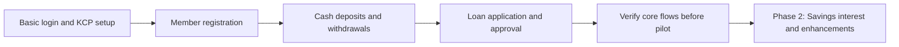

# Delivery Roadmap

Status: Initial MVP scope confirmed on 2026-10-21. Delivery order and implementation details are proposed; no dates are committed.

## Phase 1 — Core MVP

Deliver four member services through staff at any KCP:

1. Register a member using KTP/NIK and prevent duplicate membership across KCPs.
2. Accept a cash deposit into the member's savings account.
3. Process a cash withdrawal subject to available balance.
4. Handle a loan application and Supervisor approval/rejection. Disbursement is deferred by the project owner.

Use Go, Next.js, one cooperative, and shared member records across KCPs. Teller handles input and financial operations; Supervisor approves loans within assigned authority. Member is a domain role; a member self-service login is not required for this phase.

### Small implementation steps

| Step | Deliverable | Done when |
| --- | --- | --- |
| 1 | Basic Go/Next.js structure, shadcn/ui with the selected tweakcn theme, staff login, KCP assignment, and permissions | Teller and Supervisor can access only their allowed actions |
| 2 | Member form, lookup, NIK uniqueness, member number, and home KCP | Registration succeeds once and duplicate attempts are rejected across KCPs |
| 3 | One savings account type, cash deposit/withdrawal, receipt/reference, and transaction history | Balance and cash records reconcile; retries do not duplicate transactions; concurrent withdrawals cannot overdraw |
| 4 | Simple loan form, responsible KCP, and Supervisor approval/rejection | Approval follows explicit authority checks; no disbursement endpoint or cash movement is available |
| 5 | Basic verification and pilot readiness | Core scenarios pass, accounts reconcile, and backup restoration and operating procedures are demonstrated before real use |

Keep transaction posting, exact monetary values, journal records, actor/KCP history, and retry protection underneath the simple screens. These are correctness foundations, not separate large feature projects. Basic KCP and staff setup may be seeded or managed with a minimal interface; a full administration dashboard is unnecessary.

For lending, use one product and a small explicit authority rule set. Do not build a configurable workflow or general-purpose approval engine. Record the agreed amount/product/risk checks directly. Missing rules must not grant unlimited approval.

### Decisions needed only for the affected work

- Registration: required KTP fields, handling incorrect NIK, and any eligibility restrictions.
- Savings: IDR 50,000 initial deposit application, minimum retained balance, and allowed withdrawal amounts. No automated savings interest in Phase 1.
- Lending: one product's annual interest policy (if any), tenor, repayment schedule, approval limits, and disbursement conditions. Savings interest settings must not be reused as loan pricing.
- Before live lending: include a basic repayment path and agreed principal/interest allocation, or an explicitly approved and reconciled external servicing process. A disbursement-only demo is not a complete live lending service. Basic in-system installment recording is the proposed minimum addition; advanced collections remain deferred.
- Before real money: minimum accounting mappings, cash handling, corrections, access checks, and recovery procedures.

These decisions can be made when their step is reached. They do not all block starting the project or implementing registration.

## Phase 2 — Savings interest and requested enhancements

Implement the already agreed annual whole-balance savings interest model: daily calculation and monthly credit, global rate, and Supervisor-managed bands. Resolve OQ-018 through OQ-022 at this stage, not as Phase 1 prerequisites.

Add further features only when requested: richer reports, dedicated cash-session/closing screens, configurable approval administration, member portal, additional products, integrations, and advanced collections. Basic cash tracing and accounting correctness remain in Phase 1 even when richer operational screens are deferred.

## Progress

- [x] Record the simplified four-service MVP and defer advanced features.
- [x] Implement staff access and minimal KCP setup.
- [x] Implement registration and duplicate prevention.
- [x] Implement cash deposits and withdrawals.
- [x] Allocate separate savings account numbers and support exact cross-KCP lookup.
- [x] Add a dedicated transaction menu with exact account filtering, Today/Last 7 days/Last 30 days/inclusive Custom dates in Asia/Jakarta, and 50-row pagination.
- [x] Implement loan applications and decisions; disbursement and repayment explicitly deferred.
- [ ] Verify core flows and prepare a controlled pilot.
- [ ] Implement savings interest in Phase 2.

## Phase 1 lending clarification (2026-10-21)

The project owner explicitly selected loan application and approval only. Disbursement, repayment scheduling, and repayments are deferred until lending rules are agreed. Approval is a workflow decision and does not create loan principal, move cash, or imply disbursement eligibility. Earlier references to a live lending pilot apply only when disbursement is later introduced.
## Local implementation status

See [implementation notes](implementation.md) for completed code, verification, and assumptions. Approval is disabled by default until an explicit limit is configured. Pilot readiness remains incomplete; the documentation checkbox is not production sign-off.

- [x] Record and display atomic before/after member balance snapshots on new cash movements; preserve unknown historical values.
