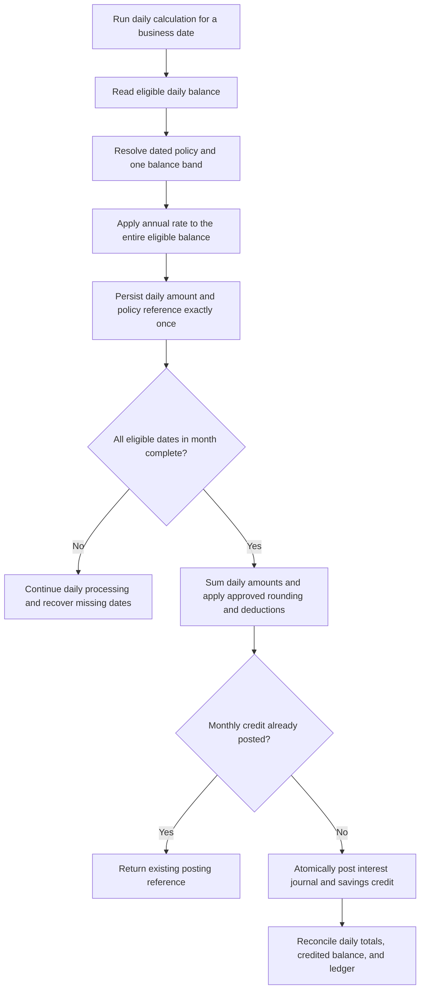

# Savings Interest Policy

> Delivery scope: Deferred to Phase 2 by [ADR-0008](adr/0008-core-mvp-first.md). The business policy remains accepted; do not build accrual jobs or configuration screens in the initial MVP.


Status: Confirmed business model with open calculation details  
Decision date: 2026-10-21

## Confirmed decisions

- These rates are interest paid on member savings balances, not interest charged on loans.
- Rates are annual percentages (p.a., per annum).
- The whole eligible balance receives one rate selected from its balance band. This is not progressive marginal tiering.
- Interest is calculated daily and credited to the savings balance monthly.
- Configuration supports a global base rate and Supervisor-managed balance bands. Actual production rates still require confirmation; the figures below were introduced as examples.
- The initial deposit amount is IDR 50,000. Its precise application to account opening versus membership contributions still needs confirmation.

Loan interest, amortization, and loan pricing remain separate, undecided policies. No flat, effective, or annuity loan method has been accepted.

## Example annual rate table

| Daily eligible balance B (IDR) | Rate applied to the entire B |
| --- | --- |
| 0 <= B < 1,000,000 | 3% p.a. |
| 1,000,000 <= B < 10,000,000 | 4% p.a. |
| 10,000,000 <= B < 100,000,000 | 4.5% p.a. |
| B >= 100,000,000 | 5% p.a. |

The global example rate is 3% p.a. Lower boundaries are inclusive and upper boundaries exclusive in this proposed table. For IDR 15,000,000, apply 4.5% to all IDR 15,000,000; do not split the balance between bands. The rate must be selected again each day if that day's balance crosses a boundary.

## Proposed calculation contract

For business date d:

```text
B[d] = eligible closing balance for date d
r[d] = annual rate selected for B[d] under the policy effective on date d
D[d] = agreed annual day-count denominator
interest[d] = B[d] * r[d] / D[d]
monthly_gross_interest = sum(interest[d] for all eligible dates in the month)
monthly_net_credit = rounded monthly gross interest minus applicable deductions
```

Rates in the formula are fractions: 3% is 0.03. The closing-balance basis is proposed, not yet approved. Do not replace the sum of daily calculations with a month-end balance multiplied by an annual rate divided by 12.

For illustration only, assuming a constant IDR 15,000,000 balance, a 4.5% rate, and a 365-day denominator, one day's unrounded interest is IDR 1,849.315068..., and 30 days total IDR 55,479.452054... before rounding or deductions. This example does not approve Actual/365 as the policy.

Uncredited daily accrual is recorded separately from spendable savings balance. Under this proposal, it does not itself earn savings interest before monthly crediting. Once credited, interest becomes part of the balance eligible on subsequent dates under the agreed posting cutoff. Finalize this timing before implementation.

## Proposed configuration lifecycle

1. An authorized Supervisor creates a dated configuration version with base rate, optional product override, and applicable balance bands.
2. Validate nonnegative rates, ordered boundaries, and absence of overlapping bands. Confirm whether gaps are forbidden or use an explicit fallback; never infer one silently.
3. Activate the version on its effective business date. Historical calculations retain their original version.
4. Select an applicable band first; otherwise apply the explicitly configured product base or global fallback. The exact precedence and gap behavior require approval.
5. Audit author, before/after values, effective date, reason, and any approval. Whether a second Supervisor must approve changes is open.

Do not recalculate previous dates merely because configuration changes. Authorized historical corrections require a separate audited adjustment process. Unlike a fixed-rate loan, a savings account may use a new rate version prospectively for future days.

## Daily calculation and monthly credit flow

The daily/monthly cadence and whole-balance band selection are confirmed. Cutoff, storage, accounting, and retry mechanics below are proposed safeguards.



Daily records should be unique per account and business date for the normal run; approved corrections are separately traceable. Monthly credits should have a unique account-period key so retries cannot pay twice. An account-level accrual failure must block that account's monthly credit until its dates are complete; other accounts may resume independently.

## Decisions required before implementation

- Eligible product, account versus member-level balance aggregation, and whether blocked or held funds earn interest.
- End-of-day balance versus another daily basis, timezone, cutoff, and credit posting date.
- Annual denominator: fixed 365, Actual/Actual with 366 in leap years, or another approved convention.
- Calculation precision, daily versus monthly rounding, currency scale, and residual handling.
- Treatment of taxes or other deductions and the required disclosures and statements.
- Opening/closure days, inactive or frozen accounts, zero or negative balances, and closure before month end.
- Credited-interest eligibility timing, backdated transactions, late jobs, and historical adjustments.
- Final rate values, base/override precedence, band-gap handling, and rate-change approval scope.
- Chart-of-accounts mapping, branch attribution, daily accrual journals versus monthly recognition, and reconciliation.

See [ADR-0007](adr/0007-daily-savings-interest-monthly-credit.md), [acceptance scenarios](acceptance.md), and [open questions](open-questions.md).
