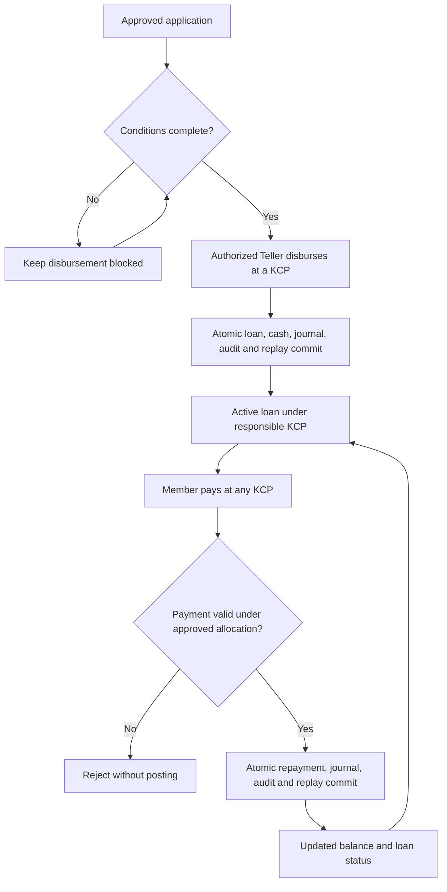
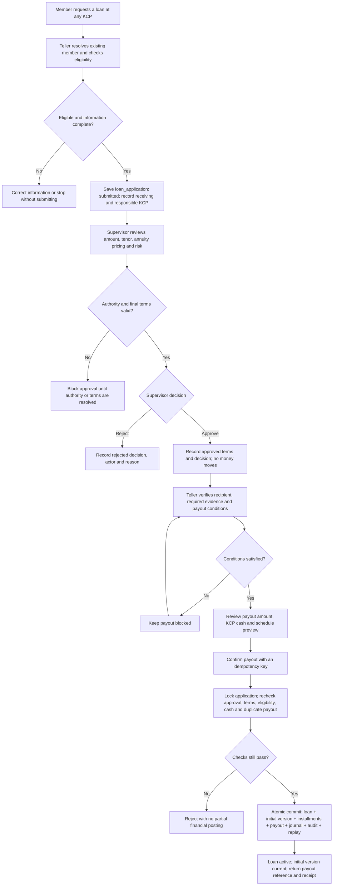
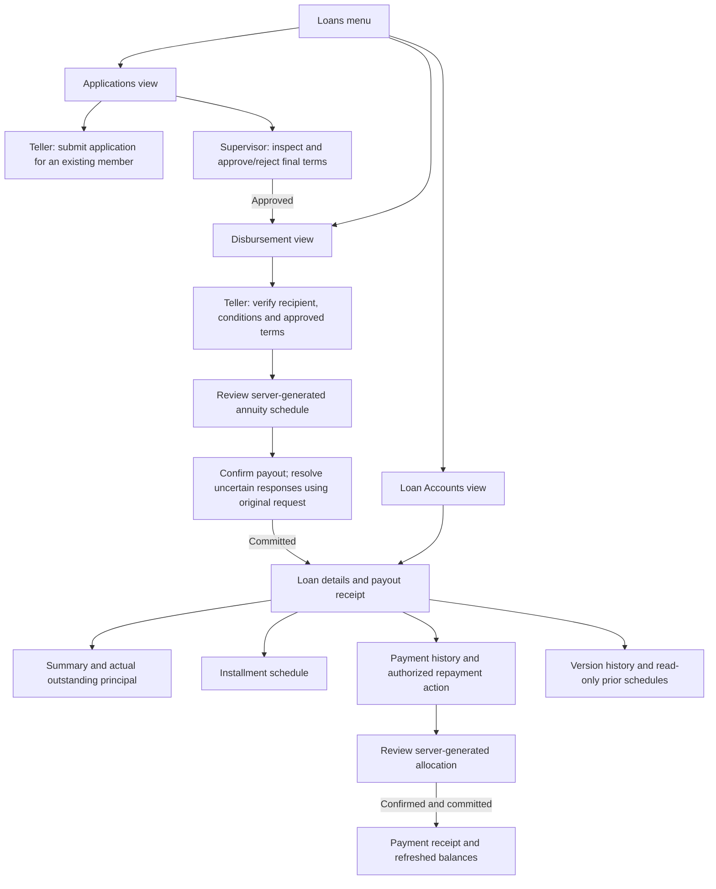

# Tech Plan - Phase 2 Acceptance and Phase 3 Lending Lifecycle

Status: Phase 2 local implementation and acceptance complete; Phase 3 plan proposed.
Date: 2026-11-09
Updated: 2026-11-10 (annuity, schedule versions, and audit discussion).
Repository baseline: main 38b4be1 (clean at inspection).

## Memory Context

- No project `*-memory-system` or project-owned `AGENTS.md` was found.
- Read the roadmap, savings-interest tech plan, ADR index and lending ADR, open questions, accounting/business-process docs, implementation notes, acceptance criteria, and current loan module.
- Savings-interest implementation and ADR-0012 are complete. Local technical reconciliation passed and the project owner accepted the local result on 2026-11-09; live-money operational readiness remains open.
- Loan intake and Supervisor approval exist. Approval changes workflow status only; it creates no loan balance or payout.
- Installments may be paid at any KCP while the responsible KCP remains unchanged.

## Phase 2 Verification (2026-11-09)

- Docker API, web, and database containers were healthy; scheduler enable flag was true.
- Policy version 1 is effective 2026-10-24 with the accepted 3%, 4%, 4.5%, and 5% bands.
- Daily closing markers and 15 account rows per day are complete from 2026-10-24 through 2026-11-08 (16 dates).
- October has 15 monthly credits totaling IDR 106,522 across 120 eligible account-days.
- Monthly arithmetic, transaction links, journals, actor/snapshot attribution, and whole-ledger invariants all reconciled with zero mismatches. Interest added no cash journal lines; total cash remained IDR 111,975,000.
- Aggregate identity: IDR 843,685,000 deposits - IDR 731,710,000 withdrawals + IDR 106,522 interest = IDR 112,081,522 total savings. Journal debits and credits each total IDR 1,575,501,522.
- Existing isolated restore evidence remains in docs/testing/savings-interest.tdd.md; restore was not repeated during this read-only check. The owner accepted the local Phase 2 result on 2026-11-09.

## Requirement

1. **Phase 2 acceptance:** technical reconciliation and local owner acceptance are complete; operational readiness for live funds remains a separate gate.
2. **Phase 3 lending lifecycle:** extend the application/decision flow to support authorized disbursement and basic in-system repayment, with atomic financial posting and cross-KCP servicing.

Non-goals: new savings-interest features, configurable loan products, member self-service, automated collections, approval workflow engine, partial/staged disbursement, rescheduling, write-off, penalties, tax handling, or a general-ledger/worker redesign.

## Backend Scope

### Phase 2 acceptance

No application implementation is planned unless read-only checks find a defect; any defect requires a separate scoped fix. Do not manually alter financial data to make checks pass.

- Read interest status and completed business-date markers from the local deployment.
- Confirm the effective policy and daily calculations cover eligible dates beginning 2026-10-24.
- Confirm October settlement is complete after its due time (2026-11-01, 00:05 Asia/Jakarta). Reconcile each account's exact daily numerator total, rounded credit, balance snapshots, and journal.
- Confirm no teller-cash movement, duplicate account/month credit, or credit with missing eligible dates.
- Record scheduler lag/failure status; if local data is acceptance evidence, compare an isolated restore/re-run.
- Record owner acceptance separately from technical reconciliation. If settlement is absent or reconciliation differs, stop acceptance and investigate before manual recovery or real-money use.

### Phase 3 lending lifecycle

Keep the feature in `backend/internal/loan` and the current PostgreSQL transaction model. Reuse Gin, staff auth, durable command replay, audit, and journal patterns. Keep `cmd/api/main.go` limited to wiring/lifecycle.

- Add one disbursement action for an approved application after required conditions are recorded and verified.
- Create a loan lifecycle record and post cash disbursement at the servicing KCP atomically.
- Record repayments at any KCP while retaining the loan's responsible KCP and recording servicing KCP separately.
- Atomically update loan state/balances with transaction, balanced journal, audit, and idempotent command result.
- Enforce roles, case scope, and state transitions in the backend. Same-key retries return the original result; changed payload conflicts.
- Add focused loan status/payment-history projections only as needed by staff screens.
- Explicitly block unsupported cases. Do not invent pricing, allocation, fees, arrears, or accounting rules.

## Codebase Context

- Existing loan module: `backend/internal/loan/{domain.go,service.go,postgres_store.go,http.go}`.
- Current `loans` rows store application facts and decision fields; statuses are `submitted`, `approved`, `rejected`, and product is constrained to `regular`.
- Cash posting hardcodes savings deposit/withdrawal effects. Reusing it for loans would incorrectly mutate savings. Use a loan-owned posting path or a small reviewed shared primitive.
- Financial posting uses a caller-owned PostgreSQL transaction, double-entry journal, audit, and durable replay.
- `docs/accounting.md` leaves loan mappings, interest/payment allocation, KCP balancing, reversals, and period rules open. ADR-0005 remains Proposed.
- Schema changes require a new forward migration. Do not edit baseline schema or applied migrations.

## API Design

Final routes and payloads depend on approved product rules. Preserve staff session/role guards, strict decoding, same-origin protection, safe errors, and idempotency conventions. Expected command boundaries (route names illustrative): disburse one approved application after conditions; record a repayment using amount and authenticated servicing KCP; read loan status and bounded payment history.

Reject non-approved/incomplete applications, duplicate disbursement, invalid or unsupported repayment, and requests outside staff scope. Never accept actor, KCP, business timestamp, or accounting account values from clients.

These are additive endpoints/projections coordinated with the frontend. Preserve existing application/decision contracts. Apply `api-contract-review` before implementation; define pagination if history exceeds existing bounds.

## Decisions Required Before Phase 3 Implementation

Resolve the following with product/accounting owners and prepare worked examples:

- **OQ-009:** product pricing (annuity selected on 2026-11-10; annual rate, periodic conversion, tenor meaning, schedule, rounding, and fees remain open) and payment allocation to interest/principal/fees.
- **OQ-011:** disbursement evidence/conditions, single versus staged payout, approval expiry, and payout KCP.
- **OQ-012:** supported late/partial/early payment, settlement, arrears, rescheduling, write-off, and closure. Explicitly block unsupported cases.
- **OQ-006/OQ-007:** chart of accounts, loan receivable/cash mappings, and central versus KCP-balanced books/inter-KCP clearing.
- **OQ-003/OQ-010:** responsible-KCP reassignment after payout and authority limits/risk for final terms.
- Reversal/correction authorization, business dates, closed-period behavior, and cash receipt/uncertain-payment procedure.

Do not reuse savings-interest rates or infer loan rules from them. Disbursement-only is not a complete lending pilot; in-system repayment and reconciliation (or an owner-approved reconciled external process) are required.

## Proposed Workflow



This outline is not authorization to pay a loan. Exact transitions and journal entries depend on approved rules.

## Implementation Plan

1. **Complete (2026-11-09):** verified status, completed dates, October settlement, account-level arithmetic and aggregate ledger reconciliation read-only. No rates or historical data were changed.
2. Resolve Phase 3 product, accounting, authority, disbursement-condition, and repayment decisions above; revise the plan if the agreed scope differs.
3. Draft and obtain acceptance for a new ADR covering loan product, posting model, KCP dimensions, and supported exceptions. Keep ADR-0005 historical and supersede it only if the new decision replaces it.
4. Add acceptance examples and forward-migration design for lifecycle, disbursement, repayment, journals, and state/uniqueness constraints. Preserve existing applications and APIs.
5. Implement allocation/calculation and state rules with tests first; add authorized idempotent commands and atomic persistence in `internal/loan`.
6. Add reconciliation for servicing-KCP cash, loan receivable, approved principal/interest allocation, and remaining balance. Verify populated restore/replay in an isolated database.
7. Coordinate staff frontend implementation using the Frontend Technical Plan section below; preserve EN/ID, light/dark, and role-based actions.
8. Release only after business/accounting acceptance, backend/frontend checks, reconciliation, restore rehearsal, and operating procedures are complete.

## Test Plan

- Phase 2 read-only checks: policy/date coverage, eligible account count, exact arithmetic/rounding, October account/month uniqueness, balanced journals, balance snapshots, unchanged cash, safe retry/restart.
- Phase 3 unit tests: approved state/conditions, limits, allocation, schedule boundaries, approved late/early/partial cases, payoff/closure, overflow/rounding.
- PostgreSQL integration: atomic disbursement/repayment, same-key replay, changed-payload conflict, concurrent duplicate payout/repayments, overpayment handling, journal/audit rollback, cross-KCP servicing with stable responsible KCP, permissions, transition races.
- Reconciliation: outstanding principal equals payouts less principal repayments/authorized reversals; cash matches approved loan accounts; interest/fees match policy; savings do not change.
- Migration/recovery: upgrade populated Phase 1/2 DB, restore isolated DB, compare schema/data/accounting digests, replay without duplicate postings.
- After implementation: `cd backend && go test -race ./...`, `go vet ./...`, Go lint, and frontend lint/typecheck/tests/build. Do not run tests during this planning-only change.

## Risks & Mitigations

- Unapproved financial policy: block implementation/posting until written decisions and expected journal examples are accepted.
- Cross-KCP imbalance: distinguish servicing cash from responsible KCP and resolve central-versus-branch accounting before rollout.
- Duplicate movement/races: row locks, uniqueness, caller-owned transaction, durable idempotency, and concurrency tests.
- Compatibility: forward-only migration/additive API; preserve application records and contracts.
- Unsupported repayment exception: reject explicitly; never silently allocate fees, interest, or arrears to principal.
- Recovery: verify backups; never delete/rewrite postings; correct only through an approved reversal policy.

## Open Questions

Phase 3 decisions above remain unresolved and block financial implementation. Phase 2 local technical reconciliation and owner acceptance are complete; live-money operational readiness remains open.

## Implementation Handoff

- This update changes only this technical plan; no implementation, schema, tests, configuration, roadmap, or ADR is changed by the 2026-11-10 planning revision.
- For implementation use `tdd-workflow`, `coding-standard`, `go-patterns`, and `go-lint-workflow`; keep changes scoped.
- Apply `error-handling`, `api-contract-review`, `observability-check`, `database-migrations`, and `postgres-patterns` at relevant boundaries.
- Do not implement lending financial posting until open product/accounting decisions and a proposed ADR are accepted.

## Phase 3 Discussion Record (2026-11-10)

This section records the owner's latest design direction and replaces conflicting earlier assumptions in this plan. It is a planning update only.

### Recorded decisions and proposal boundaries

- Use the loan-specific prefix `loan_*`, rather than `lender_*`: the cooperative is the lender; the member is the borrower.
- Separate applications from disbursed loans. Application intake and approval already exist in Phase 1; Phase 3 adds disbursement, schedules, repayments, allocation, and outstanding-principal tracking.
- Keep one responsible KCP on the loan; receiving, disbursing, and repayment-servicing KCPs are distinct facts. Repayments are accepted at any KCP.
- Use versioned schedules with `version_number` and boolean `is_current_version`. Remove the earlier proposed `supersedes_version_id`.
- Retain old versions, installments, and payment allocations when a new version becomes current.
- Record annuity as the selected calculation method. No loan interest rate has been selected; savings rates are unrelated.
- Record the universal audit-column standard and operational soft-delete predicate below. Financial history exceptions were accepted in discussion.
- The following six-table layout and individual column details are a proposed implementation design, not an already applied schema.
- The first delivery creates the initial schedule version. Actual restructuring remains deferred until carryover and approval rules are agreed; version support alone does not enable a restructuring command.

### Common audit columns on every table

The owner requested these columns on all tables, including the six lending tables. Extending existing tables requires a separately sequenced audit retrofit within this plan.

| Column | PostgreSQL type | Meaning |
| --- | --- | --- |
| `is_active` | boolean NOT NULL DEFAULT true | Record availability; separate from business lifecycle status |
| `created_by` | bigint | Creator identity; FK/nullable rules depend on truthful historical/system attribution |
| `created_at` | timestamptz NOT NULL | Creation time assigned by the database |
| `updated_by` | bigint NULL | Last modifying actor |
| `updated_at` | timestamptz NULL | Last modification time |
| `deleted_by` | bigint NULL | Soft-deleting actor |
| `deleted_at` | timestamptz NULL | Soft-deletion time |

For new staff commands, creator/updater/deleter identity comes from the authenticated actor, never client input. Use database timestamps. Update audit fields atomically with the domain change and audit event; a retry does not rewrite the original event.

Use a constraint requiring `deleted_by` and `deleted_at` to be both present or both absent, and require deleted records to have `is_active = false`. A merely inactive record may have no deletion timestamp. Update-field pairing and actor FK rules must be finalized consistently before DDL.

Existing rows may lack a known creator. Preserve known timestamps/actors; retain documented unknown or system attribution instead of inventing a human creator. Existing interest transactions/system audit already allow a constrained NULL actor. Decide how audit actor columns represent system jobs and legacy unknowns before enforcing NOT NULL or a system identity migration.

### Query and deletion policy

Operational master/draft eligibility queries use:

```sql
WHERE is_active = true
  AND deleted_at IS NULL
```

Apply the predicate explicitly to the relevant table aliases, including command eligibility checks. Deactivation and posting must serialize on the affected domain row to avoid checking eligibility before a concurrent deactivation.

The agreed financial exception is mandatory:
- Posted transactions, journals, disbursements, repayments, allocations, accepted schedule versions, and historical calculation/policy records remain available to audit and reconciliation. Corrections use authorized linked reversal entries.
- Do not soft-delete posted money or historical financial facts. Retain audit columns even where deletion is prohibited.
- Historical joins must still resolve an inactive/deleted member, user, or KCP; do not silently drop money rows through filtered INNER JOINs.
- Audit logs, idempotency/replay lookup, migration bookkeeping, and background-job completeness queries require explicit treatment. Hiding replay or completed-job records can duplicate postings. Do not introduce a generic filter that silently applies to these queries.
- A non-current schedule remains `is_active = true`, `deleted_at = NULL`. Only `is_current_version` changes.
- Preserve cooperative-wide NIK and savings-account uniqueness across inactive/deleted members. Do not replace these with partial active-only uniqueness.
- Member deactivation must not silently change savings-interest eligibility; confirm such behavior separately before changing the existing calculation.
- Master/draft soft deletion requires authorization and domain checks. Do not use cascading financial deletes. Unsupported cancellation, restoration, and identity-correction flows remain blocked until defined.

### Proposed lending columns

All tables below also contain the seven shared audit columns. Monetary values are whole-IDR bigint, never binary floating point. Lifecycle strings and numeric policy limits remain subject to the final product decision.

**1. `loan_applications`: requests and decisions**

| Column | Type | Purpose |
| --- | --- | --- |
| `id` | bigint PK | Application identity |
| `application_number` | varchar UNIQUE | Staff-facing reference |
| `member_id` | bigint FK | Applicant |
| `receiving_branch_id` | integer FK | Intake KCP |
| `responsible_branch_id` | integer FK | Case owner |
| `product_code` | varchar | One initial product |
| `requested_amount` | bigint | Requested principal |
| `requested_tenor_months` | integer | Requested tenor |
| `purpose` | text | Purpose |
| `risk` | varchar | Risk category |
| `status` | varchar | Proposed submitted/approved/rejected/cancelled lifecycle |
| `approved_amount` | bigint NULL | Approved principal |
| `approved_tenor_months` | integer NULL | Approved tenor |
| `decision_by` | bigint FK NULL | Deciding Supervisor |
| `decision_at` | timestamptz NULL | Decision time |
| `decision_reason` | text NULL | Decision explanation |
| `authority_limit` | bigint NULL | Preserve existing recorded approval authority |

Preserve existing approval facts. Approval must bind the final pricing terms before payout; the representation of approved rate/method and reapproval after term changes is still an open decision.

**2. `loans`: disbursed contracts**

| Column | Type | Purpose |
| --- | --- | --- |
| `id` | bigint PK | Loan identity |
| `loan_number` | varchar UNIQUE | Staff-facing loan number |
| `application_id` | bigint FK UNIQUE | Original application; proposed one full payout |
| `member_id` | bigint FK | Borrower |
| `responsible_branch_id` | integer FK | Loan owner KCP |
| `disbursing_branch_id` | integer FK | Payout KCP |
| `principal_amount` | bigint | Original disbursed principal |
| `disbursement_transaction_id` | text FK UNIQUE | Financial posting reference |
| `disbursed_at` | timestamptz | Actual payout time |
| `status` | varchar | Proposed active/paid_off lifecycle |
| `closed_at` | timestamptz NULL | Loan completion time |

Create the loan, initial version/installments, disbursement, journal, audit, and replay result atomically. Version rows carry immutable pricing/tenor snapshots; the original version preserves original terms. Actual outstanding principal is reconciled from posted disbursements, principal allocations, and approved correcting entries. Add a cached projection only if needed, updated in the same locked transaction.

**3. `loan_schedule_versions`: terms and schedule revisions**

| Column | Type | Purpose |
| --- | --- | --- |
| `id` | bigint PK | Version identity |
| `loan_id` | bigint FK | Loan |
| `version_number` | integer | Sequence within loan |
| `is_current_version` | boolean NOT NULL DEFAULT false | Current contractual schedule |
| `version_type` | varchar | Why the version exists: initial or restructure; separate from version number |
| `effective_date` | date | Start of contractual effect |
| `starting_principal` | bigint | Principal scheduled by this version |
| `interest_rate_bps` | integer | Annual rate; 300 represents 3%, illustrative only |
| `interest_method` | varchar | Annuity for the initial implementation |
| `tenor_months` | integer | Version tenor |
| `first_due_date` | date | First installment due date |
| `status` | varchar | Proposed draft/active/superseded approval lifecycle |
| `reason` | text | Initial issue or revision explanation |
| `approved_by` | bigint FK NULL | Version approver |
| `approved_at` | timestamptz NULL | Approval time |

`status` tracks approval/lifecycle, `is_current_version` tracks schedule selection, and `is_active` tracks record availability; enforce valid combinations. Do not derive current version solely from maximum version number.

**4. `loan_schedules`: installments in one version**

| Column | Type | Purpose |
| --- | --- | --- |
| `id` | bigint PK | Installment identity |
| `schedule_version_id` | bigint FK | Parent version |
| `installment_number` | integer | Sequence starting at 1 |
| `due_date` | date | Due date |
| `principal_due` | bigint | Scheduled principal |
| `interest_due` | bigint | Scheduled interest |

Total installment is principal_due + interest_due. Derive paid/unpaid amounts from allocations and approved reversals rather than duplicating mutable totals. One installment per tenor month assumes monthly payments; frequency, first/last partial periods, and month-end handling remain to be confirmed.

**5. `loan_repayments`: actual receipts**

| Column | Type | Purpose |
| --- | --- | --- |
| `id` | bigint PK | Receipt identity |
| `loan_id` | bigint FK | Loan paid |
| `repayment_number` | varchar UNIQUE | Receipt number |
| `transaction_id` | text FK UNIQUE | Journal-linked financial transaction |
| `servicing_branch_id` | integer FK | Receiving KCP |
| `amount` | bigint | Actual money received |
| `paid_at` | timestamptz | Actual receipt time |
| `note` | text NULL | Optional explanation |

The receiving Teller is captured by created_by and the financial actor. The final supported payment channels and correction representation require approval; no payment channel engine is planned.

**6. `loan_repayment_allocations`: receipts applied to installments**

| Column | Type | Purpose |
| --- | --- | --- |
| `id` | bigint PK | Allocation identity |
| `repayment_id` | bigint FK | Actual receipt |
| `schedule_id` | bigint FK | Installment paid |
| `principal_amount` | bigint | Principal component paid |
| `interest_amount` | bigint | Interest component paid |

This permits one receipt to cover multiple installments and one installment to receive partial payments. Exact support and allocation order remain product decisions; the schema does not authorize arbitrary partial/advance payments.

Enforce same-loan membership for repayment and schedule (through the schedule version), nonnegative components with positive total, and aggregate allocations equal to the receipt. Use explicit service validation under a loan lock plus appropriate database constraints; row CHECK constraints alone cannot enforce cross-row sums. Consider unique (repayment_id, schedule_id) for one combined allocation per pair.

### Schedule version types

The owner requested an explicit category describing why a version was created. Use version_type (renamed from the earlier change_type proposal), independently of version_number and is_current_version.

| version_type | Meaning | Scope |
| --- | --- | --- |
| initial | First contractual schedule created at disbursement | Initial Phase 3 delivery |
| restructure | Replacement schedule following approved restructuring | Planned; financial carryover and approval rules must be agreed before enabling |

Version 1 is initial. Later versions are categorized by the actual cause, not their ordinal: versions 2 and 3 may both be restructure. Keep reason as required human-readable context, with the approving actor and timestamp retained separately.

Potential future categories include rate_change for an approved contractual rate revision and schedule_correction for an approved correction to future unpaid installments. These are examples only, not enabled types or approved workflows. A routine rate reset already covered by a contract needs its own policy before deciding whether it creates a version. Corrections must never rewrite posted payments or historical allocations.

Use a bounded database CHECK/service allowlist for supported types, extended through a forward migration when a new workflow is approved. Do not add a configurable version-type master table for this MVP. Validate initial as the first version and require the appropriate approval for any replacement; version_type does not itself authorize activation.

### Current-version activation and restructuring

Required uniqueness:

```sql
CREATE UNIQUE INDEX loan_schedule_version_number
ON loan_schedule_versions (loan_id, version_number);

CREATE UNIQUE INDEX loan_schedule_one_current_version
ON loan_schedule_versions (loan_id)
WHERE is_current_version = true;

CREATE UNIQUE INDEX loan_schedule_installment_number
ON loan_schedules (schedule_version_id, installment_number);
```

The current-version uniqueness predicate intentionally excludes is_active/deleted_at. A soft-delete flag must not permit a second current financial version. The index guarantees at most one; service transaction rules ensure an active loan has exactly one current version.

Under a lock on the loan row, validate the approved change, prepare the complete new version/installments with current=false, clear the old current flag, activate the new version, and commit atomically with audit/replay. On failure, roll back all changes. Repayment allocation and version activation take the same loan lock, with one documented ordering for shared cash/KCP locks.

Do not activate a future-effective version immediately; retain the old version until the effective date. Automated future activation is not included without a separate decision. Reject unsupported scheduling rather than silently switching early.

Never edit accepted installment amounts, erase old schedules, or move historical allocation foreign keys onto the new version. Carryover must explicitly reconcile outstanding principal, unpaid/accrued interest, arrears, and rounding adjustments. Restructuring does not automatically capitalize unpaid interest or reset a borrower's debt.


### Application through disbursement flow (proposed)

The member is the borrower; the cooperative is the lender. Phase 1 already supports staff-assisted application and approval. This describes the proposed Phase 3 extension, not an existing payout feature. The initial proposal is one full cash disbursement; final product and payout conditions remain subject to the open decisions.



| Step | Role | Main stored result |
| --- | --- | --- |
| Intake | Teller | Application, member, receiving KCP, responsible KCP, requested amount/tenor/purpose/risk |
| Analysis and decision | Supervisor within authority | Approved final terms or rejected decision, reason and actor |
| Payout preparation | Teller | Verification of approved conditions and recipient; final evidence fields remain to be defined |
| Disbursement | Authorized Teller | Active loan, version 1 of type initial/current, all installments, financial posting, audit and replay result |

Approved final terms must include principal, annual loan rate, annuity method, tenor, and the agreed due-date/rounding rules. Approval binds these terms; changing material terms requires reapproval. The storage representation and exact product values are still open. A schedule preview before payout does not create principal or a current financial version.

At successful payout, create the loan and its entire initial schedule in the same database transaction as the financial posting:
- loans references the approved application and actual disbursing KCP.
- loan_schedule_versions has version_number=1, version_type=initial, is_current_version=true, and a snapshot of the approved terms.
- loan_schedules contains the agreed number of installments; their principal total equals the actual disbursed principal.
- The proposed journal is Dr loan principal receivable / Cr cash at the disbursing KCP, pending approval of the account mappings and branch accounting.
- The member's savings balance is unaffected for the proposed cash payout.
- The application retains its approval evidence. The linked unique loan/application relation proves it has been disbursed; API representation of this fact must preserve existing application contracts.

The application row lock and unique loans.application_id prevent concurrent double disbursement. Cash validation and posting use the same servicing-KCP cash lock as other cash writers, with a documented consistent lock order. Commit all loan/schedule/financial/audit/replay records together or roll back all of them. Repeating the same command returns the original reference; a new key cannot bypass the unique application payout constraint.

Physical cash handover is governed by a separate approved Teller SOP; a database commit cannot atomically hand over banknotes. If the response is uncertain, retrieve/replay the original result before any new payout or cash handover. Reprinting a receipt must not post another transaction.

Receiving KCP, responsible KCP, and disbursing KCP remain distinct. Operational eligibility checks use active/not-deleted masters, while historic approval/financial attribution remains readable. This flow adds no general-purpose workflow engine or separate analysis role.

### Annuity calculation

Annuity was selected for the planned loan method. For equal regular periods and an unchanged periodic rate:

```text
P = principal being scheduled
r = interest rate per payment period
n = number of installments

A = P * r / (1 - (1 + r)^(-n))
interest[k] = opening_principal[k] * r
principal[k] = A - interest[k]
closing_principal[k] = opening_principal[k] - principal[k]
```

For r=0, use A=P/n to avoid division by zero. With timely regular payments, scheduled principal portions increase and interest portions decrease while the unrounded regular payment stays constant. Outstanding principal decreases. Fixed-principal effective payments instead have constant principal and declining totals; flat interest uses original principal. These alternatives were discussed but are not the selected direction.

Proposed conversion for monthly nominal pricing: r = annual_rate_bps / 10000 / 12. This conversion, fixed versus floating pricing, annual-rate value, day-count/stub-period rules, and payment frequency are not yet approved. Savings Actual/365 rules do not automatically apply to loans.

Store contractual terms as a version snapshot. Calculate using exact rational or justified high-precision decimal arithmetic, never float64 money calculations. Define rounding mode/stage and bounds before implementation. Whole-IDR schedules may require a slightly different last payment: allocate the remaining principal to the final installment so sum(principal_due)=starting_principal and the closing scheduled principal is exactly zero. Do not silently write off principal, generate negative principal, or independently round components in a way that breaks installment totals.

The earlier 12-million/12-month/12%-p.a. example was illustrative, not an approved tariff. Add owner-approved examples with expected rounded rows before coding.

Contractual schedules and actual balances are distinct. Do not rewrite historical schedules based on payment timing. The treatment of overdue/early payments, additional interest, and payoff remains undecided.

### Migration and implementation sequence

1. Finalize remaining monetary/operating decisions and the corresponding ADR before loan financial implementation.
2. Inventory every existing table and classify queries as master eligibility, financial posting, immutable history, replay/job bookkeeping, or technical maintenance. Plan the all-table audit rollout explicitly, not as an implicit generic ORM scope.
3. Add audit fields through forward migrations. Preserve existing known created_by/created_at fields. Backfill known values only; document unknown/system attribution. Deploy compatible writers before enforcing stronger constraints. Assess table-lock time and batch large backfills; verify on an isolated populated restore.
4. Separate the current application-shaped loans table from disbursed loans using a coordinated forward migration and application deployment. Preserve application IDs, authority/decision history, audit/replay data, and existing /loans array/request/response contracts. Do not blindly rename the live table while old binaries still query it. Document maintenance/compatibility strategy before implementation.
5. Add new loan/version/installment/payment/allocation tables, FK/unique/check constraints, and financial posting account/kind support. Migrate no application to a disbursed loan without an actual authorized payout.
6. Implement the pure annuity calculator, initial schedule, and approved state transitions with focused tests. Keep Gin handlers, service rules, and pgx persistence in the existing loan module.
7. Implement idempotent disbursement and repayment with safe errors, sanitized logs, transaction rollback, lock ordering, and cross-KCP cash/loan reconciliation. Extend financial history projections without altering savings balances.
8. Add current-version replacement only when restructuring carryover/approval/effective-date rules have been agreed. Until then, expose only initial version creation.
9. Preserve frontend EN/ID and light/dark when the backend feature is integrated. This update does not implement frontend screens.
10. Roll out only with reconciled backup/restore evidence and the explicitly approved operational scope. Do not roll back to an incompatible binary after new financial postings; prefer a forward fix.

### Additional validation and remaining decisions

Future validation must cover:
- Active/deleted master filtering, truthful legacy/system actors, authorization, deletion-field consistency, immutable financial history, inactive-parent joins, NIK/account non-reuse, and replay after deactivation without duplicate money.
- Zero-rate annuity, approved monetary examples, rate/tenor bounds, precision and monthly/final rounding, exact principal sum, no negative installment, month-end/leap-year dates, and schedule-versus-actual balance separation.
- Concurrent new versions, unique version/ordinal constraints, exactly one current schedule for active loans, activation rollback, repayment versus version-change races, and retained old allocations.
- Same-loan allocation validation, exact receipt/component totals, partial/advance/overpayment behavior only as approved, journal failure rollback, and immutable original payment references after correction.
- Populated migration/restore parity for current applications, savings interest, audit history, sessions, command replay, loans and installments. Confirm all prior savings/cash reconciliation still holds.

Still open: actual annual loan rate and fixed/floating policy; periodic conversion; rounding; installment frequency and first due date/month-end/stub rules; payment allocation priority; late/early/partial/advance/overpayments; fees/penalties; approval of final pricing; payout conditions/expiry; restructuring carryover/activation; loan accounting and cross-KCP balancing; system/legacy audit identity and exact technical-table retention rules. The schedule data model is not a substitute for these decisions.

## Frontend Technical Plan - Phase 3 (2026-11-10)

Status: Proposed frontend design, explicitly requested by the owner. This extends the backend-focused plan above; it does not approve outstanding financial rules.

### Navigation and menu count

Retain the existing single Pinjaman / Loans sidebar entry. Add three internal views:

| View | Purpose | Staff actions |
| --- | --- | --- |
| Pengajuan / Applications | Submitted, approved and rejected applications; intake and decisions | Teller submits; authorized Supervisor reviews and decides |
| Pencairan / Disbursement | Approved applications awaiting payout | Teller verifies conditions, reviews approved terms and confirms payout |
| Daftar Pinjaman / Loan Accounts | Disbursed loans, active by default with access to paid-off history | Staff inspect details; Teller records eligible repayments |

This introduces no additional sidebar entry: Teller continues to see five main menus (Members, Cash Deposit, Cash Withdrawal, Loans, Transactions); Supervisor sees six including Savings Interest. Payment is an action in loan details, not an extra top-level menu. Do not create menus corresponding to database tables.

Application decision belongs in application details, not a separate approval menu. Schedule versions and installment schedules belong in loan details. No restructuring editor/action in the first delivery.

### Screen flow



### Applications view

- Reuse the existing application intake/decision behavior and /loans contract while the backend separates application and active-loan storage.
- Search by application number, member/account number, and agreed bounded filters/status. Use an exact account lookup for selection; do not depend exclusively on the current latest-100 member dropdown.
- Show application reference, member/account, requested/approved principal and tenor, receiving/responsible KCP, status and decision.
- Teller form: member, requested amount, tenor, purpose, responsible KCP, and risk according to existing permissions.
- Supervisor review: application facts, analysis/reason, applicable authority, final principal/rate/annuity/tenor/due-date terms, and authoritative schedule preview.
- Final pricing field ownership and persistence are an open backend/product decision. Do not expose unrestricted Teller rate edits or derive authority solely from the Supervisor role.
- Approval/rejection includes confirmation, reason and submitting state. Preserve entered values after recoverable failures; display field errors near their inputs.
- After approval, offer navigation to the payout case; do not enable payout solely from a browser status label.

### Disbursement view

- List approved applications that have no committed payout; support exact application/account lookup.
- Detail shows member identity appropriate to staff permissions, account/reference, responsible KCP, approved principal, annual loan rate, annuity method, tenor, first due date, receiving KCP and actual servicing KCP.
- Show required condition checks/evidence defined by the final policy. A browser checkbox alone cannot establish backend eligibility.
- Show server-authoritative cash availability, payout eligibility and blocked reasons. Recheck on submission.
- Display a read-only annuity preview: installment number, due date, opening principal, principal due, interest due, installment total and closing scheduled principal. Opening/closing values can be projections; they need not be extra persisted columns.
- Label the preview as a schedule, distinguish it from actual outstanding balances, and disclose any approved final-installment rounding adjustment.
- Confirmation identifies the member, payout amount, KCP and agreed terms. Disable repeated submission while pending.
- On success, open the active loan detail/receipt and refresh the affected payout queue and cash state.
- A committed payout cannot be submitted again from a new request key. On an uncertain response, retain the original request identity and show recovery/retry for that same command; do not invite another cash payout. Follow the agreed physical-cash SOP.
- Receipt includes loan/application references, member, amount, timestamp, Teller, servicing KCP and financial reference. Printing/reprinting reads the committed result.

### Loan details and repayments

Loan Accounts defaults to active loans, but historical/paid-off loans remain reachable. Provide these four detail sections:

| Detail section | Content |
| --- | --- |
| Ringkasan / Summary | Original disbursed principal, actual remaining principal, current terms/version, status and responsible KCP |
| Jadwal Angsuran / Installments | Current contractual schedule, due/allocated/unpaid components and derived payment state |
| Pembayaran / Payments | Actual receipts, principal/interest allocations, servicing KCP/Teller, timestamps and references |
| Riwayat Versi / Versions | Version number/type, effective date, current marker, reason, approver and read-only installment details |

- Keep actual remaining principal distinct from the scheduled remaining principal at a selected installment.
- Version 1 displays type initial and a current badge. Old versions remain readable when a future approved workflow replaces them; is_current_version=false is not deletion.
- Repayment starts from the selected loan: server determines allowed amount/allocation under the approved policy; Teller reviews before confirmation.
- Show per-installment principal/interest allocation and total. The client does not choose arbitrary allocation rules or recalculate posting amounts.
- Preserve request identity on ambiguous failures and refresh actual loan balance, schedule allocation and payment history after success.
- The data model supports multiple allocations, but partial/advance/late/overpayments and reversals stay disabled until their rules and corresponding backend actions exist.
- Payment UI is a later increment of this same Phase 3 plan, dependent on approved allocation rules; application-through-payout UI can be implemented earlier for local review. This sequencing does not make a payout-only flow a complete live lending service.

### Components and data ownership

Follow the current Next.js Client Component, api helper, preferences provider, shadcn/ui primitives and tweakcn theme. No new UI library, global state manager, or workflow engine is needed.

- Keep page.tsx as navigation/wiring for this feature. Add a small loan workspace component with focused intake/review, payout and loan-detail components when their behavior warrants separation.
- Prefer a small explicit view state for applications/disbursement/accounts and selected application/loan IDs. Do not store duplicate derived balances or permissions.
- Use the existing Button, Input, Card, Badge and appropriate accessible primitives. Keep one-off layout local; extract shared pagination only if actual reuse keeps it simpler.
- Fetch bounded list/detail/preview data through existing api conventions. Abort obsolete lookups and bind displayed results to the selected record/query; hide old member details immediately when lookup input changes.
- Server preview, approval and payout must agree on the same terms/version. Invalidate preview/confirmation when terms change, and handle stale-term conflicts by reloading/reviewing rather than silently accepting changed terms.
- Backend endpoints/response projections for eligibility, previews, loan detail, installments and allocations must be finalized with this UI. Route names remain unspecified until API design; preserve existing application callers.
- Add additive response fields/capabilities as needed; the backend remains authoritative for permissions, status, active/deleted eligibility, accounting and calculations.
- Proposed 20 rows per list/detail page, following the owner's existing table preference. Coordinate server pagination for new endpoints; do not silently present the first 100 rows as the full loan/application history. Pagination tokens/filters/count semantics must be agreed in the API contract.

### Roles, language, theme and accessibility

- Teller: submit applications, perform authorized payout and eligible payment commands.
- Supervisor: inspect/analyze, approve/reject within authority, and monitor. Do not grant Teller cash commands to Supervisor implicitly.
- Member remains a domain role; member self-service login/screens are not in this delivery.
- Translate all new labels, validation errors, status/version-type badges, confirmation text, loading/empty/error messages and receipts into EN/ID using the existing message dictionary.
- Show money with the existing locale formatter and dates in Asia/Jakarta. Display p.a. explicitly for annual loan rates.
- Use semantic theme tokens for light/dark; ensure schedules, dialogs, receipts, disabled controls and error states remain legible in both.
- Provide keyboard-reachable actions, input labels, table captions/column headers, visible focus, confirmation focus handling and status announcements. Show status in text, not color alone.
- Keep forms usable on narrow screens and wide schedule tables horizontally scrollable without compressing monetary columns.

### Frontend delivery and validation

1. Confirm navigation, role matrix, product/rate/rounding/due-date/allocation rules and required API projections with the backend plan.
2. Extend application intake/review using existing contract compatibility, including exact member lookup and approved-term preview.
3. Build payout queue, eligibility/detail/confirmation, replay recovery and receipt around the new backend payout command.
4. Build loan account detail, current schedule and read-only initial version.
5. After payment rules are accepted, add payment preview/confirmation/history and allocation display. Keep restructuring read-only until separately enabled.
6. Run repository frontend lint, typecheck, meaningful behavior tests and production build; verify EN/ID, both themes, keyboard operation, responsive schedules, stale lookup/preview, permission denial, duplicate clicks, ambiguous responses and refreshed balances/queues.
7. Rebuild and restart the affected Docker service after implementation changes, as requested by the owner. Verify health and homepage, then inspect the actual application flows. This documentation-only update has no runtime image changes.

No frontend code or tests are changed or executed by this planning update. Navigation and screen organization above are proposed; unresolved financial policies are still implementation blockers.
