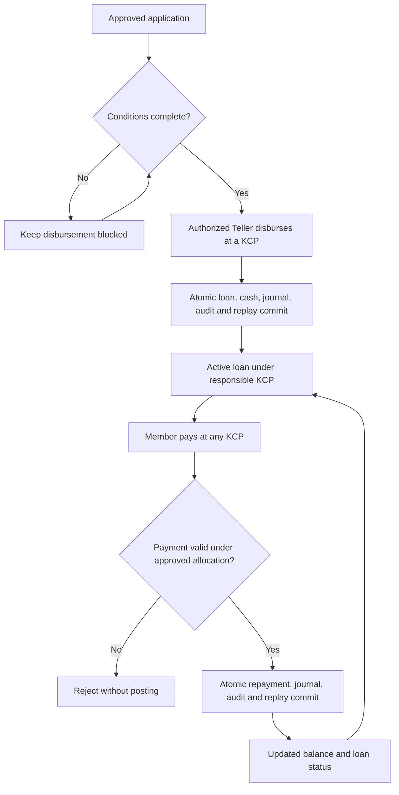

# Tech Plan - Phase 2 Acceptance and Phase 3 Lending Lifecycle

Status: Phase 2 local implementation and acceptance complete; Phase 3 plan proposed.
Date: 2026-11-09
Repository baseline: main (clean at inspection).

## Memory Context

- No project `*-memory-system` or project-owned `AGENTS.md` was found.
- Read the roadmap, savings-interest tech plan, ADR index and lending ADR, open questions, accounting/business-process docs, implementation notes, acceptance criteria, and current loan module.
- Savings-interest implementation and ADR-0012 are complete. Local technical reconciliation passed and the project owner accepted the local result on 2026-11-09; live-money operational readiness remains open.
- Loan intake and Supervisor approval exist. Approval changes workflow status only; it creates no loan balance or payout.
- Installments may be paid at any KCP while the responsible KCP remains unchanged.

## Phase 2 Verification (2026-11-09)

- Docker API, web, and database containers were healthy; scheduler enable flag was true.
- Policy version 1 is effective 2026-10-24 with the accepted 3%, 4%, 4.5%, and 5% bands.
- Daily closing markers and 15 account rows per day are complete from 2026-10-24 through 2026-11-08 (16 dates).
- October has 15 monthly credits totaling IDR 106,522 across 120 eligible account-days.
- Monthly arithmetic, transaction links, journals, actor/snapshot attribution, and whole-ledger invariants all reconciled with zero mismatches. Interest added no cash journal lines; total cash remained IDR 111,975,000.
- Aggregate identity: IDR 843,685,000 deposits - IDR 731,710,000 withdrawals + IDR 106,522 interest = IDR 112,081,522 total savings. Journal debits and credits each total IDR 1,575,501,522.
- Existing isolated restore evidence remains in docs/testing/savings-interest.tdd.md; restore was not repeated during this read-only check. The owner accepted the local Phase 2 result on 2026-11-09.

## Requirement

1. **Phase 2 acceptance:** technical reconciliation and local owner acceptance are complete; operational readiness for live funds remains a separate gate.
2. **Phase 3 lending lifecycle:** extend the application/decision flow to support authorized disbursement and basic in-system repayment, with atomic financial posting and cross-KCP servicing.

Non-goals: new savings-interest features, configurable loan products, member self-service, automated collections, approval workflow engine, partial/staged disbursement, rescheduling, write-off, penalties, tax handling, or a general-ledger/worker redesign.

## Backend Scope

### Phase 2 acceptance

No application implementation is planned unless read-only checks find a defect; any defect requires a separate scoped fix. Do not manually alter financial data to make checks pass.

- Read interest status and completed business-date markers from the local deployment.
- Confirm the effective policy and daily calculations cover eligible dates beginning 2026-10-24.
- Confirm October settlement is complete after its due time (2026-11-01, 00:05 Asia/Jakarta). Reconcile each account's exact daily numerator total, rounded credit, balance snapshots, and journal.
- Confirm no teller-cash movement, duplicate account/month credit, or credit with missing eligible dates.
- Record scheduler lag/failure status; if local data is acceptance evidence, compare an isolated restore/re-run.
- Record owner acceptance separately from technical reconciliation. If settlement is absent or reconciliation differs, stop acceptance and investigate before manual recovery or real-money use.

### Phase 3 lending lifecycle

Keep the feature in `backend/internal/loan` and the current PostgreSQL transaction model. Reuse Gin, staff auth, durable command replay, audit, and journal patterns. Keep `cmd/api/main.go` limited to wiring/lifecycle.

- Add one disbursement action for an approved application after required conditions are recorded and verified.
- Create a loan lifecycle record and post cash disbursement at the servicing KCP atomically.
- Record repayments at any KCP while retaining the loan's responsible KCP and recording servicing KCP separately.
- Atomically update loan state/balances with transaction, balanced journal, audit, and idempotent command result.
- Enforce roles, case scope, and state transitions in the backend. Same-key retries return the original result; changed payload conflicts.
- Add focused loan status/payment-history projections only as needed by staff screens.
- Explicitly block unsupported cases. Do not invent pricing, allocation, fees, arrears, or accounting rules.

## Codebase Context

- Existing loan module: `backend/internal/loan/{domain.go,service.go,postgres_store.go,http.go}`.
- Current `loans` rows store application facts and decision fields; statuses are `submitted`, `approved`, `rejected`, and product is constrained to `regular`.
- Cash posting hardcodes savings deposit/withdrawal effects. Reusing it for loans would incorrectly mutate savings. Use a loan-owned posting path or a small reviewed shared primitive.
- Financial posting uses a caller-owned PostgreSQL transaction, double-entry journal, audit, and durable replay.
- `docs/accounting.md` leaves loan mappings, interest/payment allocation, KCP balancing, reversals, and period rules open. ADR-0005 remains Proposed.
- Schema changes require a new forward migration. Do not edit baseline schema or applied migrations.

## API Design

Final routes and payloads depend on approved product rules. Preserve staff session/role guards, strict decoding, same-origin protection, safe errors, and idempotency conventions. Expected command boundaries (route names illustrative): disburse one approved application after conditions; record a repayment using amount and authenticated servicing KCP; read loan status and bounded payment history.

Reject non-approved/incomplete applications, duplicate disbursement, invalid or unsupported repayment, and requests outside staff scope. Never accept actor, KCP, business timestamp, or accounting account values from clients.

These are additive endpoints/projections coordinated with the frontend. Preserve existing application/decision contracts. Apply `api-contract-review` before implementation; define pagination if history exceeds existing bounds.

## Decisions Required Before Phase 3 Implementation

Resolve the following with product/accounting owners and prepare worked examples:

- **OQ-009:** product pricing (whether interest applies, rate/method, tenor meaning, schedule, fees) and payment allocation to interest/principal/fees.
- **OQ-011:** disbursement evidence/conditions, single versus staged payout, approval expiry, and payout KCP.
- **OQ-012:** supported late/partial/early payment, settlement, arrears, rescheduling, write-off, and closure. Explicitly block unsupported cases.
- **OQ-006/OQ-007:** chart of accounts, loan receivable/cash mappings, and central versus KCP-balanced books/inter-KCP clearing.
- **OQ-003/OQ-010:** responsible-KCP reassignment after payout and authority limits/risk for final terms.
- Reversal/correction authorization, business dates, closed-period behavior, and cash receipt/uncertain-payment procedure.

Do not reuse savings-interest rates or infer loan rules from them. Disbursement-only is not a complete lending pilot; in-system repayment and reconciliation (or an owner-approved reconciled external process) are required.

## Proposed Workflow

This outline is not authorization to pay a loan. Exact transitions and journal entries depend on approved rules.

## Implementation Plan

1. **Complete (2026-11-09):** verified status, completed dates, October settlement, account-level arithmetic and aggregate ledger reconciliation read-only. No rates or historical data were changed.
2. Resolve Phase 3 product, accounting, authority, disbursement-condition, and repayment decisions above; revise the plan if the agreed scope differs.
3. Draft and obtain acceptance for a new ADR covering loan product, posting model, KCP dimensions, and supported exceptions. Keep ADR-0005 historical and supersede it only if the new decision replaces it.
4. Add acceptance examples and forward-migration design for lifecycle, disbursement, repayment, journals, and state/uniqueness constraints. Preserve existing applications and APIs.
5. Implement allocation/calculation and state rules with tests first; add authorized idempotent commands and atomic persistence in `internal/loan`.
6. Add reconciliation for servicing-KCP cash, loan receivable, approved principal/interest allocation, and remaining balance. Verify populated restore/replay in an isolated database.
7. Coordinate staff frontend implementation separately; preserve EN/ID, light/dark, and role-based actions.
8. Release only after business/accounting acceptance, backend/frontend checks, reconciliation, restore rehearsal, and operating procedures are complete.

## Test Plan

- Phase 2 read-only checks: policy/date coverage, eligible account count, exact arithmetic/rounding, October account/month uniqueness, balanced journals, balance snapshots, unchanged cash, safe retry/restart.
- Phase 3 unit tests: approved state/conditions, limits, allocation, schedule boundaries, approved late/early/partial cases, payoff/closure, overflow/rounding.
- PostgreSQL integration: atomic disbursement/repayment, same-key replay, changed-payload conflict, concurrent duplicate payout/repayments, overpayment handling, journal/audit rollback, cross-KCP servicing with stable responsible KCP, permissions, transition races.
- Reconciliation: outstanding principal equals payouts less principal repayments/authorized reversals; cash matches approved loan accounts; interest/fees match policy; savings do not change.
- Migration/recovery: upgrade populated Phase 1/2 DB, restore isolated DB, compare schema/data/accounting digests, replay without duplicate postings.
- After implementation: `cd backend && go test -race ./...`, `go vet ./...`, Go lint, and frontend lint/typecheck/tests/build. Do not run tests during this planning-only change.

## Risks & Mitigations

- Unapproved financial policy: block implementation/posting until written decisions and expected journal examples are accepted.
- Cross-KCP imbalance: distinguish servicing cash from responsible KCP and resolve central-versus-branch accounting before rollout.
- Duplicate movement/races: row locks, uniqueness, caller-owned transaction, durable idempotency, and concurrency tests.
- Compatibility: forward-only migration/additive API; preserve application records and contracts.
- Unsupported repayment exception: reject explicitly; never silently allocate fees, interest, or arrears to principal.
- Recovery: verify backups; never delete/rewrite postings; correct only through an approved reversal policy.

## Open Questions

Phase 3 decisions above remain unresolved and block financial implementation. Phase 2 local technical reconciliation and owner acceptance are complete; live-money operational readiness remains open.

## Implementation Handoff

- Documentation only: the roadmap and this plan were updated; no code, schema, tests, configuration, or ADR was changed.
- For implementation use `tdd-workflow`, `coding-standard`, `go-patterns`, and `go-lint-workflow`; keep changes scoped.
- Apply `error-handling`, `api-contract-review`, `observability-check`, `database-migrations`, and `postgres-patterns` at relevant boundaries.
- Do not implement lending financial posting until open product/accounting decisions and a proposed ADR are accepted.
